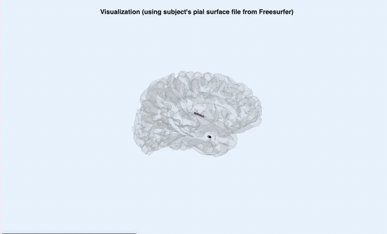
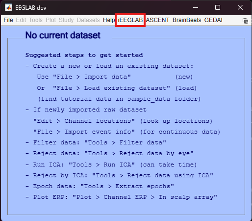
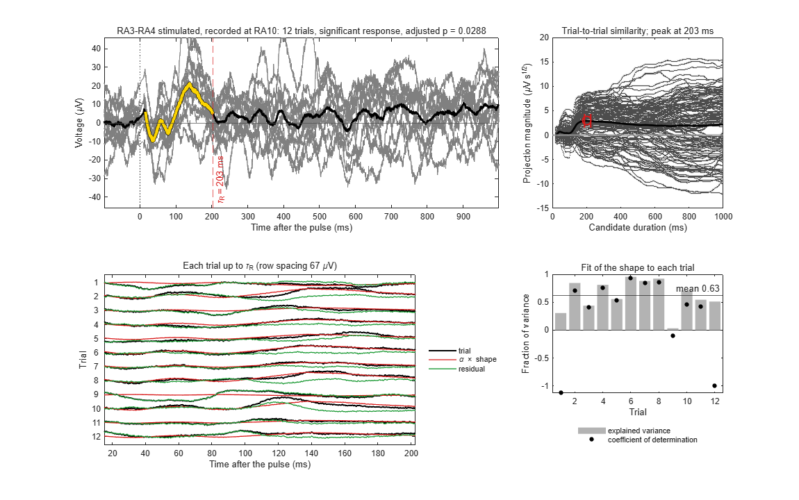
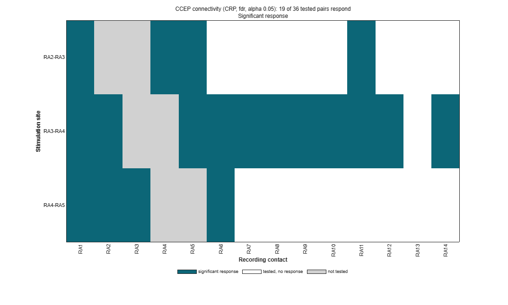

# iEEGLAB

EEGLAB plugin for intracranial EEG (stereo-EEG and ECoG), with a focus on
cortico-cortical evoked potentials (CCEP) from single-pulse electrical
stimulation. Every step runs from the EEGLAB menus or from a script.

<p align="center">
  
  <br>
  <em>sEEG electrodes on the participant's pial surface</em>
</p>

## What it does

| Step | Menu (iEEGLAB >) | Function |
|---|---|---|
| Read a raw recording of a BIDS dataset (MEF3, BrainVision, EDF, .set): brain channels by default (ECG, EMG and other types on request, for example for BrainBeats), optionally only some stimulation sites, in single precision | Import raw recording | `pop_ieeglab_import`, `ieeglab_import` |
| Or import a whole BIDS dataset with EEGLAB (every channel, double precision: fine for short recordings) | File > Import data > From BIDS folder structure | `pop_importbids` (EEG-BIDS) |
| Or FieldTrip epochs (`ft_preprocessing` output) with their electrode positions | Import FieldTrip epochs (.mat) | `ieeglab_import_fieldtrip` |
| Electrode coordinates, events and clinician channel labels from the BIDS files | Load electrode coordinates and events | `ieeglab_load` |
| The brain every brain figure is drawn on, chosen once (else the one matching the coordinates) | Choose brain surfaces | `pop_ieeglab_surfaces` |
| Electrodes on the brain | Visualize electrodes | `ieeglab_vis_elec` |
| Stimulation-artifact blanking, line-noise removal, filtering, epoching, trial and channel rejection, baseline | Preprocess iEEG data | `ieeglab_preprocess` |
| Re-referencing: CARLA (CCEP), common average, lowest-variance subset, ICA-based, bipolar, custom montages (e.g. a local average) | iEEG re-referencing | `pop_ieeglab_reref`, `ieeglab_montage` |
| Power spectrum of each contact; time-frequency power and band power (high-frequency activity by default), on the brain, with a permutation test of each contact's band power against its baseline | Frequency analysis | `pop_ieeglab_spectral`, `ieeglab_spectral`, `ieeglab_band_stats` |
| CRP (sEEG) and N1 (ECoG) with permutation statistics; connectivity matrix | CCEP analysis (N1, CRP, connectivity) | `ieeglab_stats_subject` |
| One site-contact pair (CRP), the connectivity matrix, values on the brain | Plot CRP of one site and contact; Plot connectivity matrix; Plot electrode values on brain | `ieeglab_plot_crp`, `ieeglab_plot_ccep_matrix`, `ieeglab_topoplot` |
| Export (TSV, JSON, MAT) | Export results | `ieeglab_export` |

## Installation

1. Install [EEGLAB](https://github.com/sccn/eeglab), which includes the
   **firfilt** and **EEG-BIDS** plugins that iEEGLAB uses. For raw BIDS data
   also install, from *File > Manage EEGLAB extensions*, **MEF3** (Mayo MEF3
   files), **bva-io** (BrainVision) or **Biosig** (EDF, BDF).
2. Install iEEGLAB: clone this repository into `eeglab/plugins/`, or
   [download it](https://github.com/sccn/iEEGLAB/archive/refs/heads/main.zip)
   and unzip it there. This page describes the current code. The latest
   [release](https://github.com/sccn/iEEGLAB/releases), 1.2.0, does not have the
   brain-surface step, bipolar and custom montages or frequency analysis yet.
3. Start EEGLAB and run *iEEGLAB > Check installation*
   (`ieeglab_check_install`), which lists anything missing. The iEEGLAB menu is
   right of *Help*:

   

   *Help > iEEGLAB documentation* (also at the bottom of the iEEGLAB menu)
   opens this page, the menu-by-menu walkthrough shipped with the plugin, the
   tutorial script, and the help of each menu's function.

The menus and the tutorials need no MATLAB toolbox. With the Signal Processing
Toolbox, CARLA also removes the line noise before ranking the channels.

- **Mac with Apple silicon**: compile the MEF3 reader. Its C files are in the
  MEF3 plugin folder: in MATLAB, go to `eeglab/plugins/MEF3v1.2.2` and run the
  five `mex` lines under
  [Building from source](https://github.com/MultimodalNeuroimagingLab/matmef#building-from-source).
  With MATLAB R2025b, Apple's Command Line Tools were enough.
- **fsaverage** (for coordinates in fsaverage or MNI space, such as the ECoG
  tutorial): FreeSurfer has it, or get it once from Python with
  `import mne; mne.datasets.fetch_fsaverage()` (if MNE says its download folder
  does not exist, create it first). iEEGLAB uses only `surf/lh.pial` and
  `surf/rh.pial`.

## Tutorials

Step by step through the EEGLAB menus. Each step gives what you should get, the
window or figure that opens, and the same step from the command line.

| Tutorial | Data |
|---|---|
| [sEEG: cortico-cortical evoked potentials](https://github.com/sccn/iEEGLAB/wiki/1-sEEG-CCEP-ds004696): import, preprocessing, CARLA, CRP, connectivity matrix, time-frequency power, bipolar montage | ds004696 sub-02 |
| [ECoG: cortico-cortical evoked potentials](https://github.com/sccn/iEEGLAB/wiki/2-ECoG-CCEP-ds004080): the same on fsaverage, with the common average and the N1 | ds004080 sub-ccepAgeUMCU02 |
| [FieldTrip tutorial data](https://github.com/sccn/iEEGLAB/wiki/3-FieldTrip-tutorial-data): common average of the grids, bipolar depth leads, high-frequency activity, against FieldTrip | FieldTrip's SubjectUCI29 |
| [Re-referencing compared](https://github.com/sccn/iEEGLAB/wiki/4-Re-referencing-compared): six schemes against the published CRP | ds004696 sub-02, full recording |

The first two run on small extracts of public recordings that ship with the
plugin, at their native sampling rate (2048 Hz), each in one folder: the EEGLAB
`.set` file next to its BIDS sidecar files (`electrodes.tsv`, `channels.tsv`,
`events.tsv`). Each step also gives the numbers for the full recording,
downloaded from OpenNeuro.

| Folder | Data | Source |
|---|---|---|
| `tutorial/seeg` | sEEG, 17 contacts, 3 stimulation sites, 34 pulses, pial surfaces | OpenNeuro [ds004696](https://openneuro.org/datasets/ds004696) sub-02 (Ojeda Valencia et al., 2023) |
| `tutorial/ecog` | ECoG, 20 contacts, 3 stimulation sites, 30 pulses | OpenNeuro [ds004080](https://openneuro.org/datasets/ds004080) sub-ccepAgeUMCU02 (van Blooijs et al., 2023) |

[`ieeglab_tutorial.m`](https://github.com/sccn/iEEGLAB/blob/main/ieeglab_tutorial.m)
runs the analysis of both extracts in about a minute. Results repeat exactly
from run to run: the permutation tests and CARLA's bootstrap use a fixed random
seed.

## Quick start

The sEEG tutorial extract from the command line:

```matlab
eeglab
tut = fullfile(fileparts(which('eegplugin_ieeglab')), 'tutorial', 'seeg');
EEG = pop_loadset('filename', 'sub-02_ses-ieeg01_task-ccep_run-01_ieeg.set', 'filepath', tut);
EEG = ieeglab_load(EEG, struct('event_field', 'electrical_stimulation_site'));
EEG = pop_ieeglab_surfaces(EEG, 'surf_files', ieeglab_brain_surfaces(EEG));
EEG = ieeglab_preprocess(EEG, struct('apply_blank', true, 'apply_notch', true, 'notch', [60 120 180], ...
    'apply_epoch', true, 'epoch_window', [-1000 1000], 'reject_trials', true, ...
    'remove_rare_cond', true, 'min_trials', 5, 'remove_no_coords', true, ...
    'remove_bad_channels', true, 'apply_baseline', true, 'baseline_period', [-500 -50]));
EEG = pop_ieeglab_reref(EEG, 'method', 'carla');
EEG = ieeglab_stats_subject(EEG, struct('run_n1', false, 'run_crp', true, 'run_matrix', true, 'matrix_source', 'crp'));
ieeglab_plot_crp(EEG, 'RA3-RA4', 'RA10');      % one site-contact pair
pop_ieeglab_ccep_matrix(EEG, 'response');      % connectivity matrix
pop_ieeglab_topoplot(EEG, 'in_degree');        % in-degree on the brain
ieeglab_export(EEG, 'results_seeg');
```

<p align="center">
  
  <br>
  <em>CRP of RA10 for stimulation at RA3-RA4: the trials and their average up to the response duration (yellow), the trial-to-trial similarity, each trial with the fitted shape, and the fit per trial.</em>
</p>

<p align="center">
  
  <br>
  <em>Connectivity matrix: 3 stimulation sites (rows) by 14 contacts (columns).</em>
</p>

## Re-referencing and frequency analysis

Both work on any iEEG dataset, with or without stimulation. *iEEG
re-referencing* offers what the data allow: on continuous data the common
average, ICA, bipolar and custom montages; after segmentation also CARLA and
the lowest-variance subset. On stimulation data the common average and ICA
wait for the epochs, where each pulse's stimulated pair is known and left out.
Re-referencing from this menu after *Preprocess iEEG data* gives the same
result as choosing it inside preprocessing. A bipolar montage also gives the
same result before or after preprocessing, except inside the blanked artifact
window (its default interpolation is not linear) and for the line-noise fit,
which estimates the mains frequency from all channels together.

*iEEGLAB > iEEG re-referencing > Bipolar* subtracts from each contact the next
one on its lead (`RA1-RA2` = RA1 - RA2), as FieldTrip does for depth electrodes
(Stolk et al., 2018); A'1 is on lead A', not A. Bad contacts are not paired, a
missing contact leaves a gap, and with coordinates two contacts farther apart
than twice their lead's median spacing are not paired (the end of one grid row
and the start of the next). On CCEP data a channel that uses a stimulated
contact counts as stimulated, whatever its name. A custom montage is a table,
one row per new channel: `positive` (a contact), `negative` (one contact,
several for a local average separated by spaces or commas, or `n/a`) and an
optional `name`, in a `.tsv` or `.csv` file; a FieldTrip montage (`labelold`,
`labelnew`, `tra`) also works.

*iEEGLAB > Frequency analysis* gives the power spectrum of each contact
(continuous or epoched data), or, on epoched data, time-frequency power against
a baseline and the power of a band over time and on the brain. The defaults
follow FieldTrip's intracranial tutorial: Hann windows of 0.2 s, 5 to 200 Hz,
high-frequency activity 70-150 Hz. Only windows that lie entirely inside the
baseline are used for it. On CCEP data each contact's own stimulation epochs
are left out of its average, windows that contain the pulse are left out (grey),
and the spectrum uses only stretches away from the pulses (on epochs, the part
before the pulse). Windows that touch a NaN sample are left out.
From the menu it only draws figures: the dataset is not changed.
The box under the band tests each contact's band power in the band window
against its baseline (`ieeglab_band_stats`): per epoch and frequency, 10 log10
power averaged over the window minus over the baseline, then the mean over the
band's frequencies; a sign-flip permutation test over epochs (exact with few
epochs), FDR across contacts. The significant contacts are listed, starred, and
alone on the brain, coloured by the tested change.

```matlab
EEG_bip = pop_ieeglab_reref(EEG, 'method', 'bipolar');
EEG_lap = pop_ieeglab_reref(EEG, 'method', 'montage', 'montage', 'my_montage.tsv');
EEG     = pop_ieeglab_spectral(EEG, 'type', 'spectrum');
EEG     = pop_ieeglab_spectral(EEG, 'type', 'timefreq', 'band', [70 150], ...
              'baseline', [-500 -100], 'norm', 'relchange');
ieeglab_plot_spectral(EEG, EEG.ieeglab.spectral, 'channel', 'RA10');
EEG     = pop_ieeglab_spectral(EEG, 'type', 'timefreq', 'band_window', [100 500], 'stats', true);
EEG.ieeglab.spectral.stats                     % one row per contact: band_db, t, p, p_adj, significant
```

## Validation

```matlab
results = runtests('tests');   % no figures or dialogs
```

CARLA and CRP are checked against the published implementations
(`tests/test_carla_vs_reference.m`, `tests/test_crp_vs_python.m`).

The scripts in `validation/` compare iEEGLAB with other tools and with the
authors' code on public data, some from the raw recording and some on the same
input. Each one's help says which, and what to download. The folder is not on
the path: `addpath(fullfile(fileparts(which('eegplugin_ieeglab')), 'validation'))`.

| Script | Against | Data |
|---|---|---|
| `validate_fieldtrip_uci29` | FieldTrip's intracranial tutorial (Stolk et al., 2018): re-referencing, time-frequency power, high-frequency activity | SubjectUCI29 |
| `validate_crp_scripts` | The CRP authors' code (Miller et al., 2023) | their sample data (OSF) |
| `validate_erdetect_ds004080` | ER-detect (van den Boom et al., 2025), N1 | ds004080, one run (sub-ccepAgeUMCU02) |
| `validate_icaref_michelmann` | The ICA re-referencing authors' script (Michelmann et al., 2018) | SubjectUCI29 depth leads, and simulated data |
| `validate_car_huang_ds004977` | The CARLA authors' common average (Huang et al., 2024) | ds004977 sub-1 run-02 (public samples: site RMO8-RMO9 only) |
| `validate_carla_huang_ds004977` | The CARLA authors' code (Huang et al., 2024), on the site of their Figure 5 | ds004977 sub-1 run-02, site RMO8-RMO9 |
| `compare_references_ds004696`, `matched_pipeline_ds004696`, `split_half_effects_ds004696` | The published CRP of ds004696 sub-02 (Ojeda Valencia et al., 2023), with each re-referencing scheme and with the paper's own settings ([Re-referencing compared](https://github.com/sccn/iEEGLAB/wiki/4-Re-referencing-compared)) | ds004696 sub-02 |

## Version history

Changes in each version: [CHANGELOG.md](https://github.com/sccn/iEEGLAB/blob/main/CHANGELOG.md).
Releases: [github.com/sccn/iEEGLAB/releases](https://github.com/sccn/iEEGLAB/releases).

## Citing

Please cite iEEGLAB ([CITATION.cff](https://github.com/sccn/iEEGLAB/blob/main/CITATION.cff))
and the methods you use; each method prints its reference when it runs. Much of
the CCEP methodology comes from Dora Hermes and the Multimodal Neuroimaging Lab
([github.com/MultimodalNeuroimagingLab](https://github.com/MultimodalNeuroimagingLab)).

- de Cheveigné, A. (2020). ZapLine: A simple and effective method to remove power line artifacts. *NeuroImage, 207*, 116356.
- Huang, H., Ojeda Valencia, G., Gregg, N. M., Osman, G. M., Montoya, M. N., Worrell, G. A., Miller, K. J., & Hermes, D. (2024). CARLA: Adjusted common average referencing for cortico-cortical evoked potential data. *Journal of Neuroscience Methods, 407*, 110153.
- Klug, M., & Kloosterman, N. A. (2022). Zapline-plus: A Zapline extension for automatic and adaptive removal of frequency-specific noise artifacts in M/EEG. *Human Brain Mapping, 43*(9), 2743-2758.
- Michelmann, S., Treder, M. S., Griffiths, B., Kerrén, C., Roux, F., Wimber, M., Rollings, D., Sawlani, V., Chelvarajah, R., Gollwitzer, S., Kreiselmeyer, G., Hamer, H., Bowman, H., Staresina, B., & Hanslmayr, S. (2018). Data-driven re-referencing of intracranial EEG based on independent component analysis (ICA). *Journal of Neuroscience Methods, 307*, 125-137.
- Miller, K. J., Müller, K.-R., Ojeda Valencia, G., Huang, H., Gregg, N. M., Worrell, G. A., & Hermes, D. (2023). Canonical response parameterization: Quantifying the structure of responses to single-pulse intracranial electrical brain stimulation. *PLOS Computational Biology, 19*(5), e1011105.
- Ojeda Valencia, G., Gregg, N. M., Huang, H., Lundstrom, B. N., Brinkmann, B. H., Pal Attia, T., Van Gompel, J. J., Bernstein, M. A., In, M.-H., Huston, J., III, Worrell, G. A., Miller, K. J., & Hermes, D. (2023). Signatures of electrical stimulation driven network interactions in the human limbic system. *Journal of Neuroscience, 43*(39), 6697-6711.
- Stolk, A., Griffin, S., van der Meij, R., Dewar, C., Saez, I., Lin, J. J., Piantoni, G., Schoffelen, J.-M., Knight, R. T., & Oostenveld, R. (2018). Integrated analysis of anatomical and electrophysiological human intracranial data. *Nature Protocols, 13*(7), 1699-1723.
- van Blooijs, D., Leijten, F. S. S., van Rijen, P. C., Meijer, H. G. E., & Huiskamp, G. J. M. (2018). Evoked directional network characteristics of epileptogenic tissue derived from single pulse electrical stimulation. *Human Brain Mapping, 39*(11), 4611-4622.
- van Blooijs, D., van den Boom, M. A., van der Aar, J. F., Huiskamp, G. M., Castegnaro, G., Demuru, M., Zweiphenning, W. J. E. M., van Eijsden, P., Miller, K. J., Leijten, F. S. S., & Hermes, D. (2023). Developmental trajectory of transmission speed in the human brain. *Nature Neuroscience, 26*(4), 537-541.
- van den Boom, M. A., Gregg, N. M., Ojeda Valencia, G., Lundstrom, B. N., Miller, K. J., van Blooijs, D., Huiskamp, G. J. M., Leijten, F. S. S., Worrell, G. A., & Hermes, D. (2025). ER-detect: A pipeline for robust detection of early evoked responses in BIDS-iEEG electrical stimulation data. *Journal of Neuroscience Methods, 418*, 110389.

## License

GPL-3.0-or-later. See [LICENSE](https://github.com/sccn/iEEGLAB/blob/main/LICENSE).
