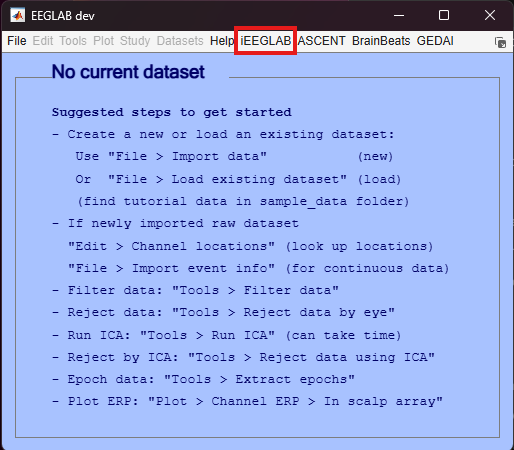
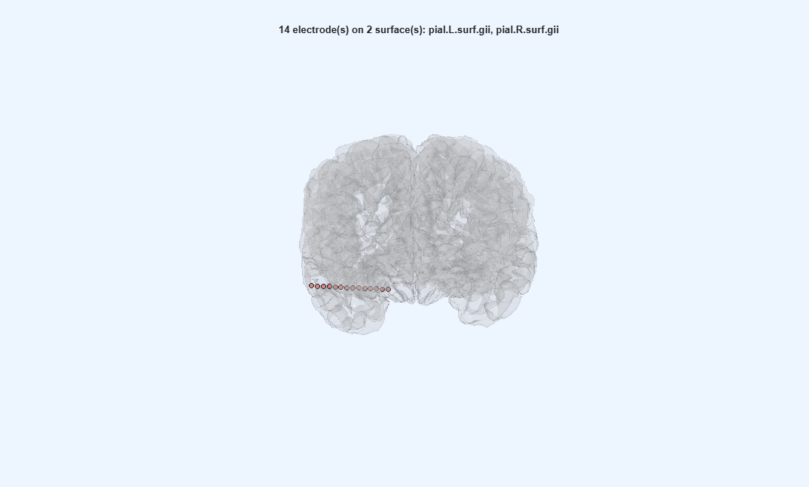
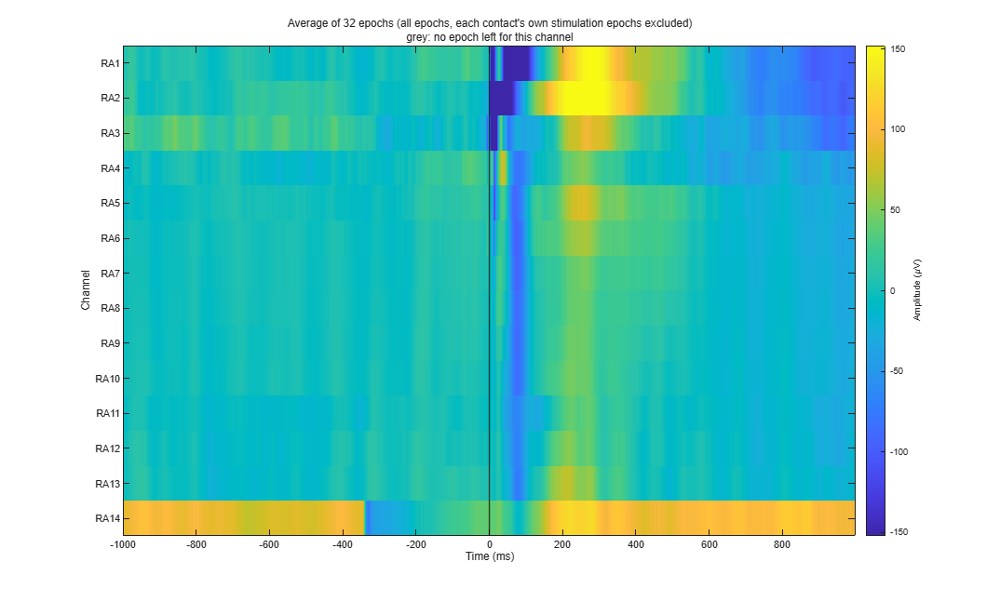
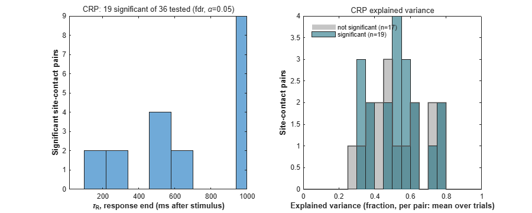
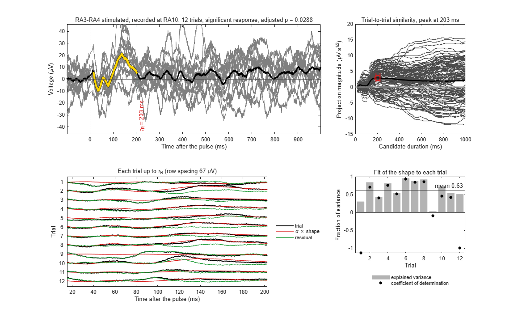
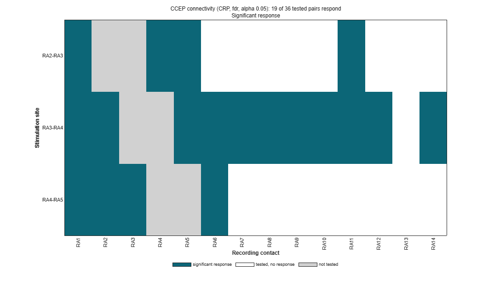
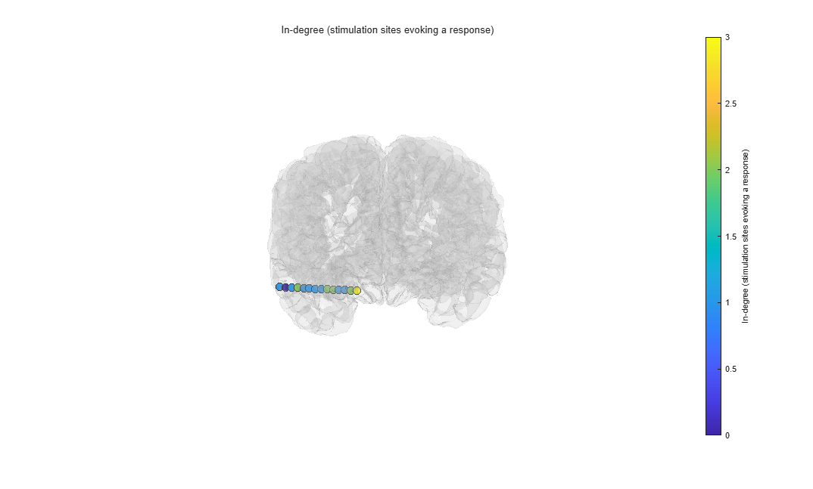
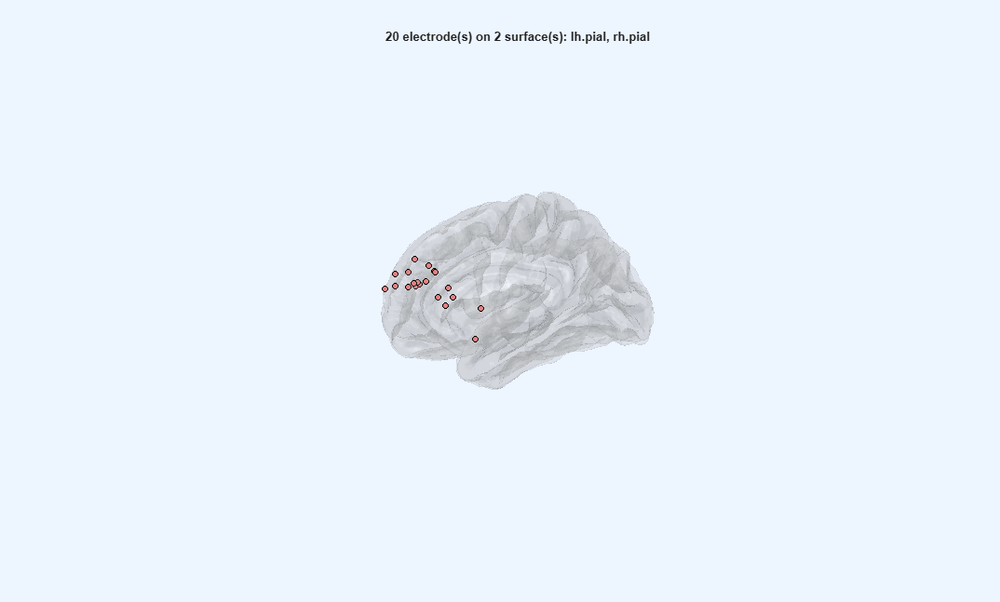
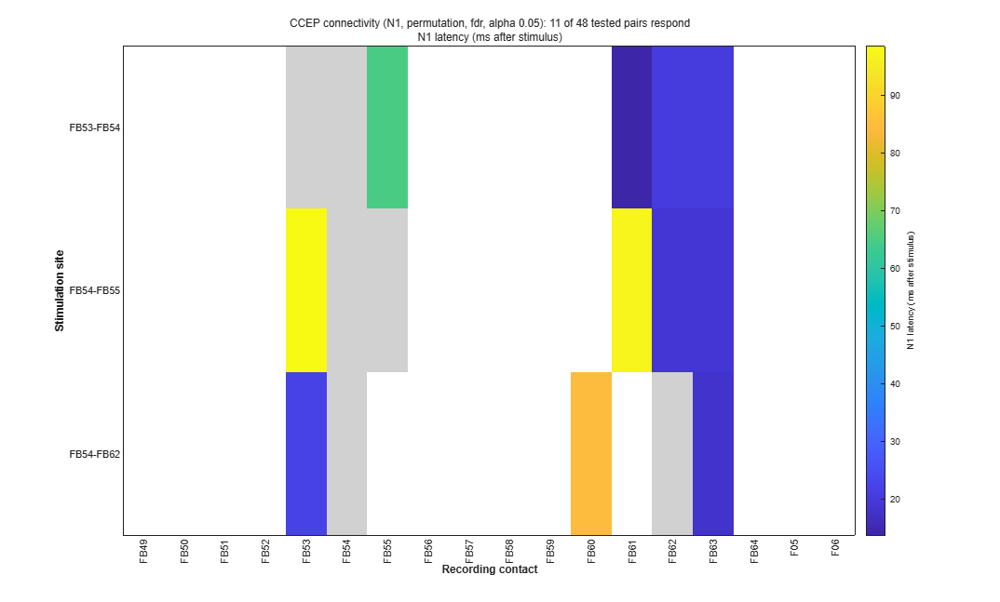
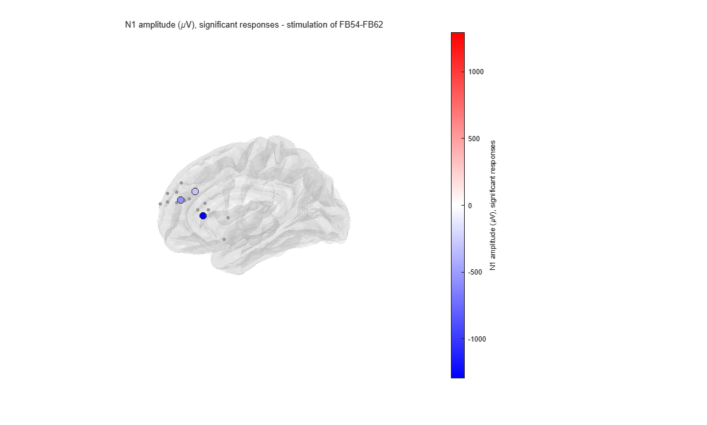

# iEEGLAB

EEGLAB plugin for intracranial EEG (stereo-EEG and ECoG), with a focus on
cortico-cortical evoked potentials (CCEP) from single-pulse electrical
stimulation. Every step runs from the EEGLAB menus or from a script.

<p align="center">
  
  <br>
  <em>sEEG electrodes on the subject's pial surface</em>
</p>

## What it does

| Step | Menu (iEEGLAB >) | Function |
|---|---|---|
| Read a raw recording of a BIDS dataset (MEF3, BrainVision, EDF, .set): brain channels by default (ECG, EMG and other types on request, for example for BrainBeats), optionally only some stimulation sites, in single precision | Import raw recording | `pop_ieeglab_import`, `ieeglab_import` |
| Or import a whole BIDS dataset with EEGLAB (every channel, double precision: fine for short recordings) | File > Import data > From BIDS folder structure | `pop_importbids` (EEG-BIDS) |
| Electrode coordinates, events and clinician channel labels from the BIDS files | Load electrode coordinates and events | `ieeglab_load` |
| The brain every brain figure is drawn on, chosen once (else the one matching the coordinates) | Choose brain surfaces | `pop_ieeglab_surfaces` |
| Electrodes on the brain | Visualize electrodes | `ieeglab_vis_elec` |
| Stimulation-artifact blanking, filtering, epoching, trial and channel rejection, baseline | Preprocess iEEG data | `ieeglab_preprocess` |
| Re-referencing: CARLA (CCEP), common average, ICA-based, bipolar, custom montages (e.g. a local average) | iEEG re-referencing | `pop_ieeglab_reref`, `ieeglab_montage` |
| Power spectrum of each contact; time-frequency power and band power (high-frequency activity by default), on the brain | Frequency analysis | `pop_ieeglab_spectral`, `ieeglab_spectral` |
| CRP (sEEG) and N1 (ECoG) with permutation statistics; connectivity matrix | CCEP analysis (N1, CRP, connectivity) | `ieeglab_stats_subject` |
| One site-contact pair (CRP), the connectivity matrix, values on the brain | Plot CRP of one site and contact; Plot connectivity matrix; Plot electrode values on brain | `ieeglab_plot_crp`, `ieeglab_plot_ccep_matrix`, `ieeglab_topoplot` |
| Export (TSV, JSON, MAT) | Export results | `ieeglab_export` |

## Installation

1. Install [EEGLAB](https://github.com/sccn/eeglab), which includes the
   **firfilt** and **EEG-BIDS** plugins that iEEGLAB uses. For raw BIDS data
   also install, from *File > Manage EEGLAB extensions*, **MEF3** (Mayo MEF3
   files) or **bva-io** (BrainVision).
2. Install iEEGLAB: download the latest
   [release](https://github.com/sccn/iEEGLAB/releases) (`iEEGLAB1.2.0.zip`) and
   unzip it into `eeglab/plugins/`, or clone this repository there. The EEGLAB
   extension manager lists 1.2.0 once its list is updated.
3. Start EEGLAB and run *iEEGLAB > Check installation*
   (`ieeglab_check_install`), which lists anything missing. The iEEGLAB menu is
   right of *Help*:

   

   *Help > iEEGLAB documentation* (also at the bottom of the iEEGLAB menu)
   opens this page, the menu-by-menu walkthrough shipped with the plugin, the
   tutorial script, and the help of each menu's function.

CARLA needs MATLAB's Statistics and Machine Learning Toolbox; the Signal
Processing Toolbox is recommended.

## Tutorial

The plugin ships two small extracts of public recordings at their native
sampling rate (2048 Hz), each in one folder: the EEGLAB `.set` file next to its
BIDS sidecar files (`electrodes.tsv`, `channels.tsv`, `events.tsv`).

| Folder | Data | Source |
|---|---|---|
| `tutorial/seeg` | sEEG, 17 contacts, 3 stimulation sites, 34 pulses, pial surfaces | OpenNeuro [ds004696](https://openneuro.org/datasets/ds004696) sub-02 (Ojeda Valencia et al., 2023) |
| `tutorial/ecog` | ECoG, 20 contacts, 3 stimulation sites, 30 pulses | OpenNeuro [ds004080](https://openneuro.org/datasets/ds004080) sub-ccepAgeUMCU02 (van Blooijs et al., 2023) |

The steps below are also in [`ieeglab_tutorial.m`](ieeglab_tutorial.m), which
runs the whole analysis in about a minute, and in `iEEGLAB_GUI_walkthrough.html`
(open it in a browser), which shows the window or figure to expect at each menu
step, for these extracts or for the full recordings as downloaded from OpenNeuro
(*iEEGLAB > Import raw recording* reads the raw MEF3 or BrainVision files).
Results repeat exactly from run to run: the permutation tests and CARLA's
bootstrap use a fixed random seed.

### Part A: sEEG

**1. Open the dataset.** *File > Load existing dataset*, and select the `.set`
file in `tutorial/seeg`.

```matlab
eeglab
tut = fullfile(fileparts(which('eegplugin_ieeglab')), 'tutorial', 'seeg');
EEG = pop_loadset('filename', 'sub-02_ses-ieeg01_task-ccep_run-01_ieeg.set', 'filepath', tut);
```

**2. Coordinates, events and channel labels.** *iEEGLAB > Load electrode
coordinates and events*. The sidecar files next to the dataset are found
automatically. The event type is the stimulation site (e.g. `RA3-RA4`). Contacts marked bad in `channels.tsv` (RA15, RB14, RB15) are
marked here and removed during preprocessing.

```matlab
EEG = ieeglab_load(EEG, struct('event_field', 'electrical_stimulation_site'));
```

**3. Electrodes on the brain.** *iEEGLAB > Choose brain surfaces*, then
*iEEGLAB > Visualize electrodes*. The brain is chosen once, here *Use these*:
the pial surfaces found next to the dataset (`pial.L.surf.gii`,
`pial.R.surf.gii`). Every brain figure then uses it without asking. Without a
choice, figures are drawn on the brain that matches the space of the
coordinates in `coordsystem.json`: the participant's pial surfaces for
participant coordinates (ACPC here), fsaverage's for fsaverage or MNI
coordinates (`ieeglab_brain_surfaces`).

```matlab
surf = fullfile(tut, {'pial.L.surf.gii', 'pial.R.surf.gii'});
EEG = pop_ieeglab_surfaces(EEG, 'surf_files', surf);
EEG = ieeglab_vis_elec(EEG);
```

<p align="center">
  
  <br>
  <em>The 14 contacts of the RA lead on sub-02's pial surfaces.</em>
</p>

**4. Preprocess.** *iEEGLAB > Preprocess iEEG data*: tick *Reject outlier
trials* and keep the other defaults (the command below sets the same). They
blank the stimulation artifact,
remove the line noise (60 Hz from the recording's `ieeg.json`, and its harmonics
120 and 180 Hz) by subtracting
sines fitted away from the pulses (no filter: a notch or a high-pass spreads each
response around the pulse), cut epochs from -1
to 1 s around each pulse, drop stimulation sites with fewer than 5 pulses,
remove the bad contacts and those without coordinates, and subtract the baseline
(-500 to -50 ms). RA14 is reported as not flat before the pulse: it is kept, as
the clinicians marked it good, but look at it in the heatmap.

The line-noise removal was compared with a notch filter, ZapLine (de Cheveigné,
2020) and ZapLine-plus (Klug & Kloosterman, 2022), on synthetic stimulation
data with a known clean signal and on both tutorial datasets. The fitted sines
left the least error 5 to 50 ms after the pulse (0.1 uV, against 0.5 uV for
the notch and 18 to 20 uV for ZapLine, whose spatial components take in the
pulses); details in the help of `ieeglab_line_noise`.

```matlab
EEG = ieeglab_preprocess(EEG, struct('apply_blank', true, ...
    'apply_notch', true, 'notch', [60 120 180], ...
    'apply_epoch', true, 'epoch_window', [-1000 1000], 'reject_trials', true, ...
    'remove_rare_cond', true, 'min_trials', 5, 'remove_no_coords', true, ...
    'remove_bad_channels', true, 'apply_baseline', true, 'baseline_period', [-500 -50]));
```

*iEEGLAB > Plot average of epochs, every channel (heatmap)* shows the average of all
epochs, one row per contact, at any step once the data are epoched:

```matlab
ieeglab_plot_heatmap(EEG);
```

<p align="center">
  
  <br>
  <em>Flat before the pulse, responses after it; RA14 (bottom row) is not flat before the pulse.</em>
</p>

**5. Re-reference.** *iEEGLAB > iEEG re-referencing*. CARLA chooses, for each
stimulation site, the channels whose common average carries no evoked
response (Huang et al., 2024), with its authors' settings for real data (sensitive
cutoff; the stimulated pair, 2 contacts on each side of it and bad contacts left
out). Keep a common-average copy and an ICA re-referenced copy (Michelmann
et al., 2018: independent components spread uniformly over the contacts, such
as the reference, are removed) to compare.

```matlab
EEG_car = pop_ieeglab_reref(EEG, 'method', 'car');
EEG_ica = pop_ieeglab_reref(EEG, 'method', 'ica');
EEG     = pop_ieeglab_reref(EEG, 'method', 'carla');
```

**6. CCEP analysis.** *iEEGLAB > CCEP analysis*. On sEEG the response is
described by the Canonical Response Parameterization (CRP; Miller et al.,
2023): duration, shape and explained variance for every site and contact,
with a permutation test. The connectivity matrix collects the significant
responses.

```matlab
EEG = ieeglab_stats_subject(EEG, struct('run_n1', false, 'run_crp', true, ...
    'run_matrix', true, 'matrix_source', 'crp'));
```

<p align="center">
  
  <br>
  <em>19 of 36 pairs respond: when the responses end (left) and how much of each trial the response shape explains (right).</em>
</p>

**7. Results.** *iEEGLAB > Plot CRP of one site and contact* shows one pair as
in Miller et al. (2023): the trials, the response shape, its duration and how
well it fits each trial (RA10 at RA3-RA4: 203 ms, 63% of each trial's variance
on average). *Plot connectivity matrix* summarizes all pairs: each row is a
stimulated pair, each column a recording contact, and a cell shows whether
stimulating that pair evoked a response at that contact (teal: significant;
white: tested, no response; grey: not tested, such as the stimulated contacts
themselves). A row shows where a site's stimulation reaches, a column which
sites reach a contact; the other views colour the responding pairs by a measure
of the response (CRP explained variance or duration, N1 amplitude or latency).
*Plot electrode values on brain* puts one value per contact on the brain, such
as the in-degree: the number of sites that evoke a response there.

```matlab
ieeglab_plot_crp(EEG, 'RA3-RA4', 'RA10');
ieeglab_plot_ccep_matrix(EEG.ieeglab.ccep_matrix);
ieeglab_topoplot(EEG, 'in_degree', 'surf_files', surf);
ieeglab_topoplot(EEG, 'crp_explained_var', 'site', 'RA3-RA4', 'surf_files', surf);
```

<p align="center">
  
  <br>
  <em>CRP of RA10 for stimulation at RA3-RA4: the trials and their average up to the response duration (yellow), the trial-to-trial similarity, each trial with the fitted shape, and the fit per trial.</em>
</p>

<p align="center">
  
  <br>
  <em>Connectivity matrix: 3 stimulation sites (rows) by 14 contacts (columns).</em>
</p>

<p align="center">
  
  <br>
  <em>In-degree: how many of the 3 sites evoke a response at each contact.</em>
</p>

**8. Export.** *iEEGLAB > Export results*: TSV tables (BIDS derivatives
style), a JSON record of every option used, and a MAT file.

```matlab
ieeglab_export(EEG, 'results_seeg');
```

### Bipolar montages and frequency analysis

Both work on any iEEG dataset, with or without stimulation. *iEEG
re-referencing* offers what the data allow: on continuous data the common
average, ICA, bipolar and custom montages; after segmentation also CARLA and
the lowest-covariance subset. On stimulation data the common average and ICA
wait for the epochs, where each pulse's stimulated pair is known and left out.
Re-referencing from this menu after *Preprocess iEEG data* gives the same
result as choosing it inside preprocessing. A bipolar montage also gives the
same result before or after preprocessing, except inside the blanked artifact
window (its default interpolation is not linear) and for the line-noise fit,
which estimates the mains frequency from all channels together.

*iEEGLAB > iEEG re-referencing > Bipolar* subtracts from each contact the next
one on its lead (`RA1-RA2` = RA1 - RA2), as FieldTrip does for depth electrodes
(Stolk et al., 2018); A'1 is on lead A', not A. Bad contacts are not paired, a missing contact leaves a gap,
and with coordinates two contacts farther apart than twice their lead's median
spacing are not paired (the end of one grid row and the start of the next). On
CCEP data a channel that uses a stimulated contact counts as stimulated,
whatever its name. A custom montage is a table, one row per new channel:
`positive` (a contact), `negative` (one contact, several for a local average
separated by spaces or commas, or `n/a`) and an optional
`name`, in a `.tsv` or `.csv` file; a FieldTrip montage (`labelold`, `labelnew`,
`tra`) also works.

*iEEGLAB > Frequency analysis* gives the power spectrum of each contact
(continuous or epoched data), or, on epoched data, time-frequency power against
a baseline and the power of a band over time and on the brain. The defaults
follow FieldTrip's intracranial tutorial: Hann windows of 0.2 s, 5 to 200 Hz,
high-frequency activity 70-150 Hz. Only windows that lie entirely inside the
baseline are used for it. On CCEP data each contact's own stimulation epochs
are left out of its average, windows that contain the pulse are left out (grey),
and the spectrum uses only stretches away from the pulses (on epochs, the part
before the pulse). Windows that touch a NaN sample are left out.
From the menu it only draws figures: the dataset is not changed.

On the tutorial (steps A10-A11 and B10 of `ieeglab_tutorial.m`, and the
step-by-step page): the sEEG's 14 contacts give 13 bipolar channels; the ECoG's
17 give 14, as the ends of two grid rows are not paired. With the default 0.2 s
windows, the times from -100 to 110 ms are grey, and no contact's 70-150 Hz
power moves by more than 0.5 dB over the second after the pulse; the spectra
show no line-noise peak in their median.

```matlab
EEG_bip = pop_ieeglab_reref(EEG, 'method', 'bipolar');
EEG_lap = pop_ieeglab_reref(EEG, 'method', 'montage', 'montage', 'my_montage.tsv');
EEG     = pop_ieeglab_spectral(EEG, 'type', 'spectrum');
EEG     = pop_ieeglab_spectral(EEG, 'type', 'timefreq', 'band', [70 150], ...
              'baseline', [-500 -100], 'norm', 'relchange');
ieeglab_plot_spectral(EEG, EEG.ieeglab.spectral, 'channel', 'RA10');
```

### Part B: ECoG

The same steps, with these differences: the coordinates are in fsaverage space
(no individual MRI is shared; *Visualize electrodes* offers fsaverage's pial
surfaces when FreeSurfer or MNE's fsaverage is installed), the line noise is
50 Hz (the command removes 50 Hz alone, as for the numbers below; with the
window's default, 50, 100 and 150 Hz, 10 of 48 pairs respond instead of 11), the
reference is the common average of the good contacts, and the CCEP
measure is the N1 (van Blooijs et al., 2018): the largest negative peak 10-100 ms
after the pulse, tested with a permutation test across trials, with erdetect's
polarity and its 50 uV floor on the baseline SD (the 3.4 SD rule of erdetect is an
option).

```matlab
tut = fullfile(fileparts(which('eegplugin_ieeglab')), 'tutorial', 'ecog');
EEG = pop_loadset('filename', 'sub-ccepAgeUMCU02_ses-1_task-SPESclin_run-041456_ieeg.set', 'filepath', tut);
EEG = ieeglab_load(EEG, struct('event_field', 'electrical_stimulation_site'));
EEG = ieeglab_preprocess(EEG, struct('apply_blank', true, ...
    'apply_notch', true, 'notch', 50, ...
    'apply_epoch', true, 'epoch_window', [-1000 1000], 'reject_trials', true, ...
    'remove_rare_cond', true, 'min_trials', 5, 'remove_no_coords', true, ...
    'remove_bad_channels', true, 'apply_baseline', true, 'baseline_period', [-500 -50]));
EEG = pop_ieeglab_reref(EEG, 'method', 'car');
EEG = ieeglab_stats_subject(EEG, struct('run_n1', true, 'run_crp', false, ...
    'run_matrix', true, 'matrix_source', 'n1'));
ieeglab_plot_ccep_matrix(EEG.ieeglab.ccep_matrix, 'latency_ms');
ieeglab_topoplot(EEG, 'n1_amplitude', 'site', 'FB54-FB62');
ieeglab_export(EEG, 'results_ecog');
```

<p align="center">
  
  <br>
  <em>The 20 ECoG contacts on fsaverage's pial surfaces. The grid looks irregular: the dataset moved its contacts to fsaverage with a surface-based transformation that distorts the grid but keeps the gyral anatomy.</em>
</p>

<p align="center">
  
  <br>
  <em>N1 latency of the responding pairs (11 of 48), in ms after the pulse.</em>
</p>

<p align="center">
  
  <br>
  <em>N1 amplitude at each contact for stimulation of FB54-FB62.</em>
</p>

## Tests

```matlab
results = runtests('tests');   % no figures or dialogs
```

CARLA and CRP are checked against the published implementations
(`tests/test_carla_vs_reference.m`, `tests/test_crp_vs_python.m`).

## Citing

Please cite iEEGLAB ([CITATION.cff](CITATION.cff)) and the methods you use;
each method prints its reference when it runs. Much of the CCEP methodology
comes from Dora Hermes and the Multimodal Neuroimaging Lab
([github.com/MultimodalNeuroimagingLab](https://github.com/MultimodalNeuroimagingLab)).

- de Cheveigné, A. (2020). ZapLine: A simple and effective method to remove power line artifacts. *NeuroImage, 207*, 116356.
- Huang, H., Ojeda Valencia, G., Gregg, N. M., Osman, G. M., Montoya, M. N., Worrell, G. A., Miller, K. J., & Hermes, D. (2024). CARLA: Adjusted common average referencing for cortico-cortical evoked potential data. *Journal of Neuroscience Methods, 407*, 110153.
- Klug, M., & Kloosterman, N. A. (2022). Zapline-plus: A Zapline extension for automatic and adaptive removal of frequency-specific noise artifacts in M/EEG. *Human Brain Mapping*. https://doi.org/10.1002/hbm.25832
- Michelmann, S., Treder, M. S., Griffiths, B., Kerrén, C., Roux, F., Wimber, M., Rollings, D., Sawlani, V., Chelvarajah, R., Gollwitzer, S., Kreiselmeyer, G., Hamer, H., Bowman, H., Staresina, B., & Hanslmayr, S. (2018). Data-driven re-referencing of intracranial EEG based on independent component analysis (ICA). *Journal of Neuroscience Methods, 307*, 125-137.
- Miller, K. J., Müller, K.-R., Ojeda Valencia, G., Huang, H., Gregg, N. M., Worrell, G. A., & Hermes, D. (2023). Canonical response parameterization: Quantifying the structure of responses to single-pulse intracranial electrical brain stimulation. *PLOS Computational Biology, 19*(5), e1011105.
- Ojeda Valencia, G., Gregg, N. M., Huang, H., Lundstrom, B. N., Brinkmann, B. H., Pal Attia, T., Van Gompel, J. J., Bernstein, M. A., In, M.-H., Huston, J., III, Worrell, G. A., Miller, K. J., & Hermes, D. (2023). Signatures of electrical stimulation driven network interactions in the human limbic system. *Journal of Neuroscience, 43*(39), 6697-6711.
- Stolk, A., Griffin, S., van der Meij, R., Dewar, C., Saez, I., Lin, J. J., Piantoni, G., Schoffelen, J.-M., Knight, R. T., & Oostenveld, R. (2018). Integrated analysis of anatomical and electrophysiological human intracranial data. *Nature Protocols, 13*(7), 1699-1723.
- van Blooijs, D., Leijten, F. S. S., van Rijen, P. C., Meijer, H. G. E., & Huiskamp, G. J. M. (2018). Evoked directional network characteristics of epileptogenic tissue derived from single pulse electrical stimulation. *Human Brain Mapping, 39*(11), 4611-4622.
- van Blooijs, D., van den Boom, M. A., van der Aar, J. F., Huiskamp, G. M., Castegnaro, G., Demuru, M., Zweiphenning, W. J. E. M., van Eijsden, P., Miller, K. J., Leijten, F. S. S., & Hermes, D. (2023). Developmental trajectory of transmission speed in the human brain. *Nature Neuroscience, 26*(4), 537-541.

Changes: [CHANGELOG.md](CHANGELOG.md).

## License

GPL-3.0-or-later. See [LICENSE](LICENSE).
