# sEEG: cortico-cortical evoked potentials (ds004696)

Single-pulse electrical stimulation through pairs of neighbouring stereo-EEG contacts, and the responses it evokes at
every other contact, analysed through the iEEGLAB menus: from the recording to the response of each site-contact pair,
the connectivity matrix, time-frequency power and a bipolar montage. The participant is sub-02 of OpenNeuro ds004696
(Ojeda Valencia et al., 2023).

Each step gives the menu, what you should get (*Expect*), the window or figure that opens, and the same step from the
command line. The screenshots are from the tutorial extract. Install iEEGLAB first
([Installation](https://github.com/sccn/iEEGLAB#installation)).

## Data

Two versions of the same recording; the steps give the numbers of both where they differ.

- **Tutorial extract**: nothing to download, a few minutes for all the steps. `tutorial/seeg` in the iEEGLAB folder
  holds an extract at the native sampling rate with its BIDS sidecar files: 17 contacts, 3 stimulation sites,
  34 pulses.
- **Full recording**: sub-02 from OpenNeuro, with the [AWS command line](https://aws.amazon.com/cli/) (no account
  needed) or from [ds004696](https://openneuro.org/datasets/ds004696). Keep the folder structure. Reading it needs the
  **MEF3** plugin (**File > Manage EEGLAB extensions**).

```
aws s3 sync --no-sign-request s3://openneuro.org/ds004696 ds004696 --exclude "*" --include "sub-02/*" --include "derivatives/freesurfer/sub-02/*" --include "dataset_description.json" --include "participants.tsv"
```

> **Note.** The full recording needs about 20 GB of memory, and CARLA takes 6 to 7 minutes. For a quicker run, read
> only a few stimulation sites at step 1; the numbers then differ a little, also for the sites you keep, as CARLA and
> the permutations draw from one random stream. The times on this page come from a Windows laptop with 8 cores; a
> recent Mac (Apple M5 Pro) was as fast or up to 3.5 times faster.

## Steps

### 1. Load the data

**Tutorial extract:** **File > Load existing dataset**: in the iEEGLAB folder,
`tutorial/seeg/sub-02_ses-ieeg01_task-ccep_run-01_ieeg.set`.

**Full recording:** **iEEGLAB > Import raw recording**: select the `ds004696` folder, then sub-02's recording. Keep the
defaults.

> **Expect.**
>
> - *Tutorial extract:* 17 channels at 2048 Hz, 3.2 minutes.
> - *Full recording:* About 1.5 minutes, with the progress in the command window and a progress bar: 237 channels at
>   2048 Hz.

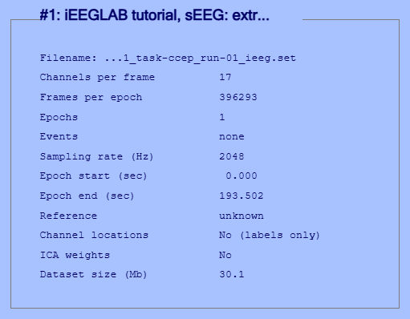

Full recording, the two import windows:

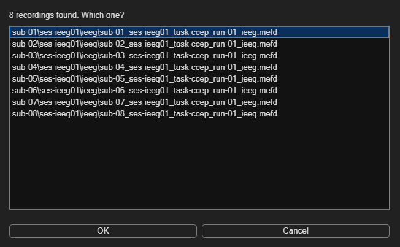

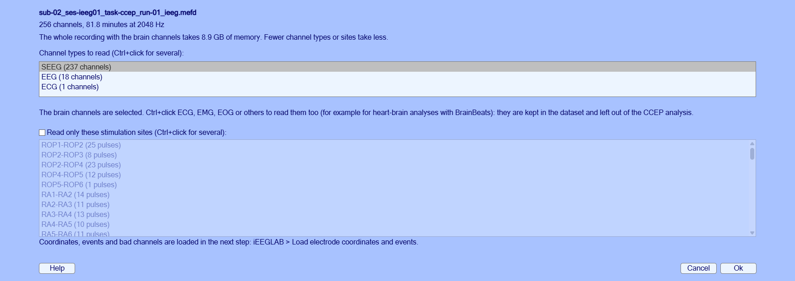

```matlab
% Tutorial extract
tut = fullfile(fileparts(which('eegplugin_ieeglab')), 'tutorial', 'seeg');
EEG = pop_loadset('filename', 'sub-02_ses-ieeg01_task-ccep_run-01_ieeg.set', 'filepath', tut);
% Full recording
rec = fullfile('ds004696', 'sub-02', 'ses-ieeg01', 'ieeg', 'sub-02_ses-ieeg01_task-ccep_run-01_ieeg.mefd');
EEG = ieeglab_import(rec);   % or ieeglab_import(rec, 'sites', {'RA2-RA3', 'RA3-RA4'})
```

### 2. Coordinates and events

**iEEGLAB > Load electrode coordinates and events**: Ok in both windows. The sidecar files next to the dataset are
found automatically; the event type is the stimulation site (for example `RA3-RA4`), and the contacts marked bad in
`channels.tsv` are marked here and removed during preprocessing.

> **Expect.**
>
> - *Tutorial extract:* 14 of 17 contacts with coordinates, 3 bad (RA15, RB14, RB15, from `channels.tsv`),
>   34 stimulations at 3 sites. A warning says that the same three have no position in the electrodes file.
> - *Full recording:* 211 contacts with coordinates, 39 bad (from `channels.tsv`), 695 stimulations.

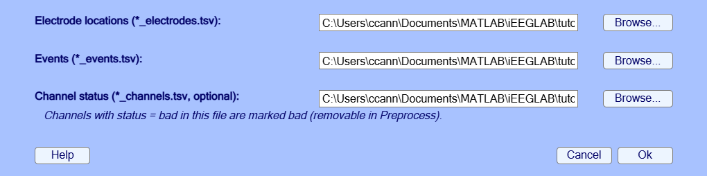

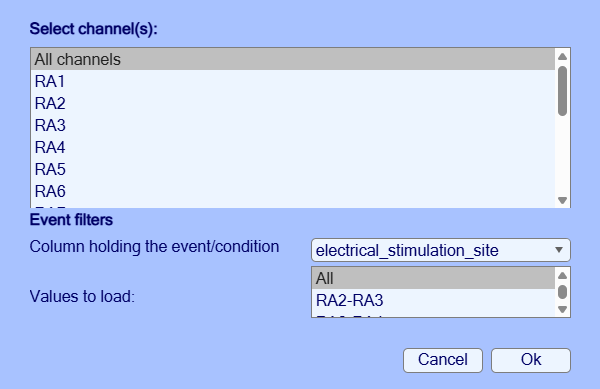

```matlab
EEG = ieeglab_load(EEG, struct('event_field', 'electrical_stimulation_site'));
```

### 3. Brain surfaces

**iEEGLAB > Choose brain surfaces**: *Use these* (sub-02's pial surfaces), then **iEEGLAB > Visualize electrodes**.
Chosen once, the surfaces are used by every brain figure. Without a choice, figures are drawn on the brain that matches
the space of the coordinates in `coordsystem.json`: the participant's pial surfaces for participant coordinates (ACPC
here), fsaverage's for fsaverage or MNI coordinates.

> **Expect.** The contacts inside the brain, seen from the front and slightly above; drag to rotate. The tutorial
> extract shows one lead (RA), in the right hemisphere.

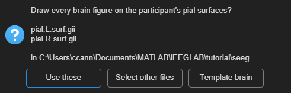

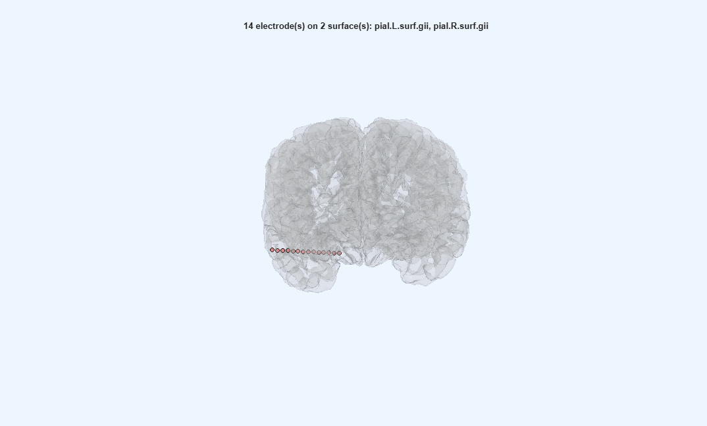

```matlab
EEG = pop_ieeglab_surfaces(EEG, 'surf_files', ieeglab_brain_surfaces(EEG));
EEG = ieeglab_vis_elec(EEG);
```

### 4. Preprocess

**iEEGLAB > Preprocess iEEG data**: tick *Reject outlier trials*, keep the rest: artifact blanking, line noise at 60,
120 and 180 Hz removed by fitted sines, no filter (a notch or a high-pass spreads each response around the pulse),
epochs -1 to 1 s, baseline -500 to -50 ms; sites with fewer than 5 pulses, bad contacts and contacts without
coordinates removed.

> **Expect.**
>
> - *Tutorial extract:* A few seconds: 14 contacts, 32 epochs. The command window names RA14 as not flat before the
>   pulse: it is kept, as the clinicians marked it good.
> - *Full recording:* About a minute: 198 contacts, 627 epochs.

> **Note.** Line noise: the fitted sines were compared with a notch filter, ZapLine (de Cheveigné, 2020) and
> ZapLine-plus (Klug & Kloosterman, 2022), on synthetic stimulation data with a known clean signal and on both
> datasets. They left the least error 5 to 50 ms after the pulse (0.1 uV, against 0.5 uV for the notch and 19 to
> 20 uV for ZapLine), and are the default. Details in the help of `ieeglab_line_noise`.

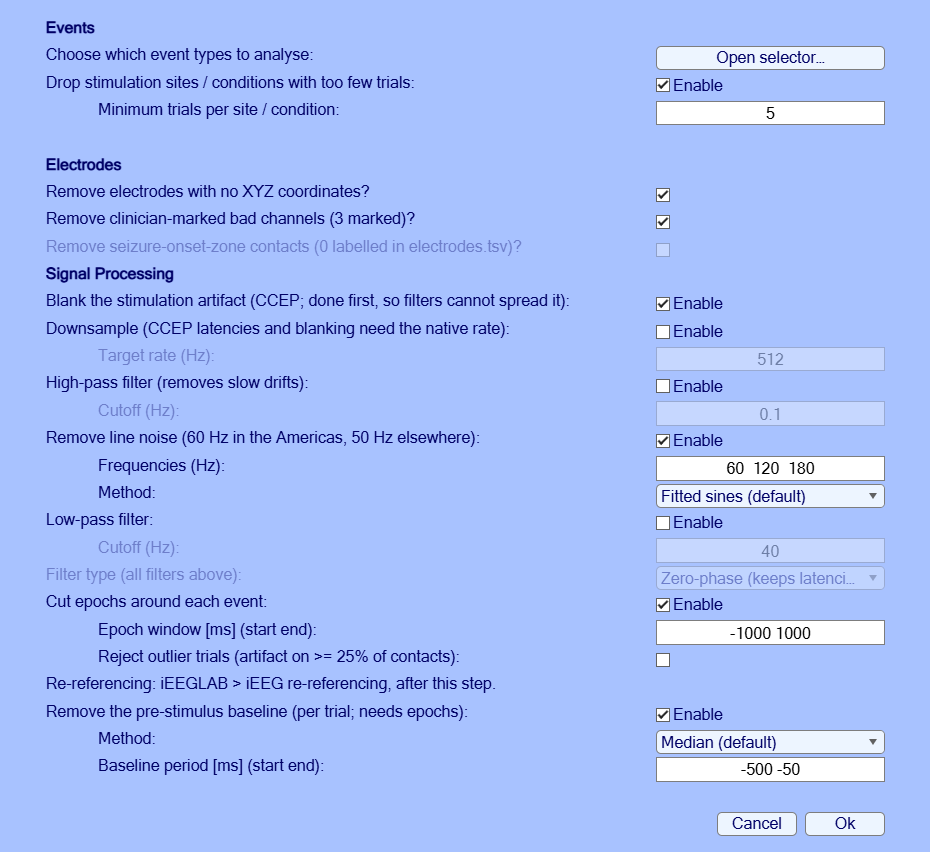

```matlab
EEG = ieeglab_preprocess(EEG, struct('apply_blank', true, 'apply_notch', true, 'notch', [60 120 180], ...
    'apply_epoch', true, 'epoch_window', [-1000 1000], 'reject_trials', true, ...
    'remove_rare_cond', true, 'min_trials', 5, 'remove_no_coords', true, ...
    'remove_bad_channels', true, 'apply_baseline', true, 'baseline_period', [-500 -50]));
```

### 5. Average heatmap

**iEEGLAB > Plot average of epochs, every channel (heatmap)**. It works at any step once the data are epoched.

> **Expect.** One row per contact, the average of all epochs in colour: flat before 0 ms, responses after it. In the
> tutorial extract, RA14 is the row that is not flat before 0 ms.

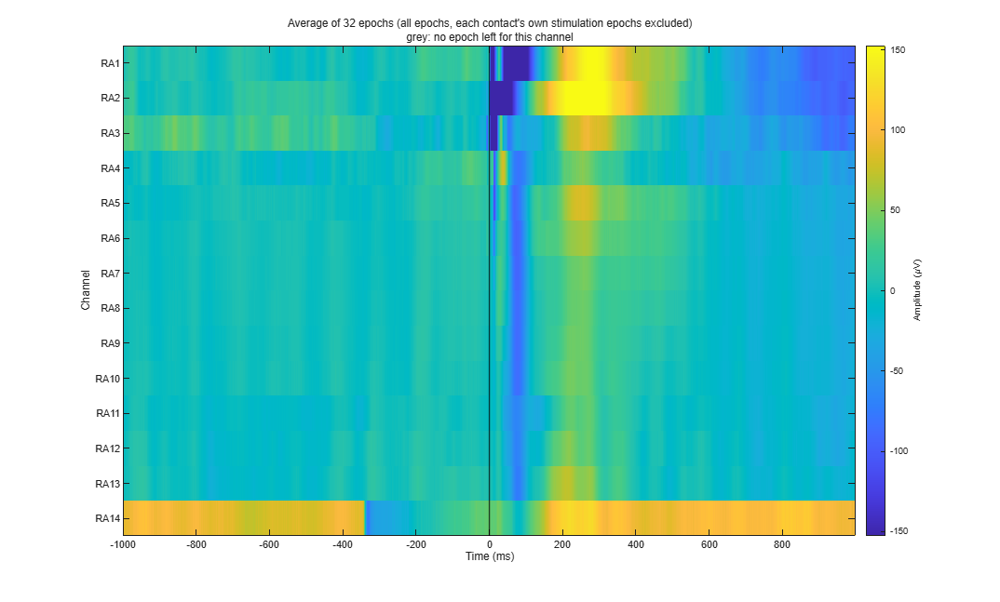

```matlab
ieeglab_plot_heatmap(EEG);
```

### 6. CARLA

**iEEGLAB > iEEG re-referencing**: CARLA, defaults. CARLA chooses, for each stimulation site, the channels whose common
average carries no evoked response (Huang et al., 2024). The defaults are its authors' settings for real data:
sensitive cutoff; the stimulated pair, 2 contacts on each side of it and bad contacts left out.

> **Expect.**
>
> - *Tutorial extract:* A few seconds for the 3 sites.
> - *Full recording:* 6 to 7 minutes for the 57 sites.

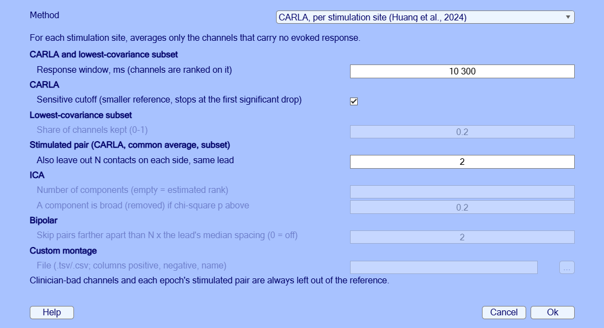

```matlab
EEG = pop_ieeglab_reref(EEG, 'method', 'carla');
```

### 7. CCEP analysis

**iEEGLAB > CCEP analysis**: defaults (CRP over 15 ms to 1 s, matrix from CRP). On sEEG the response of each
site-contact pair is described by the Canonical Response Parameterization (CRP; Miller et al., 2023): its duration,
shape and explained variance, with a permutation test. The connectivity matrix collects the significant responses.

> **Expect.** The results repeat exactly from run to run on the same data (fixed random seed).
>
> - *Tutorial extract:* A few seconds: 19 of 36 site-contact pairs respond (the stimulation sites are next to each
>   other on one lead, so most contacts respond).
> - *Full recording:* Under a minute: 3937 of 10780 site-contact pairs respond. A warning says that 392 more cannot
>   reach significance, at sites with too few trials, and count as not tested. Against the published CRP of this
>   participant: the same decision for 83% of the 484 published pairs tested here. With the paper's own settings,
>   iEEGLAB reaches the paper's decision on all 484; [Re-referencing compared](4-Re-referencing-compared.md) gives
>   what each setting changes.

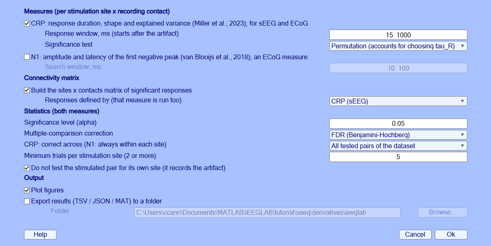

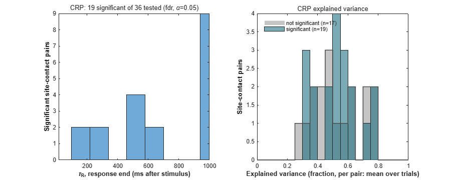

```matlab
EEG = ieeglab_stats_subject(EEG, struct('run_n1', false, 'run_crp', true, 'run_matrix', true, 'matrix_source', 'crp'));
```

### 8. CRP plots

**Tutorial extract:** **iEEGLAB > Plot CRP of one site and contact**: RA3-RA4, then RA10.

**Full recording:** **iEEGLAB > Plot CRP of one site and contact**: RX4-RX5, then RF2.

The figure shows one pair as in Miller et al. (2023): the trials and their average up to the response duration, the
trial-to-trial similarity, each trial with the fitted shape, and the fit per trial.

> **Expect.**
>
> - *Tutorial extract:* Response duration 203 ms; the shape explains on average 63% of each trial's variance.
> - *Full recording:* Response duration 232 ms (published: 234 ms); the shape explains on average 98% of each trial's
>   variance.

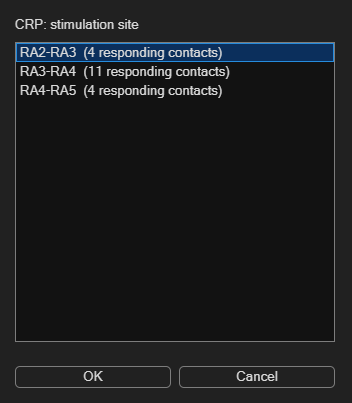

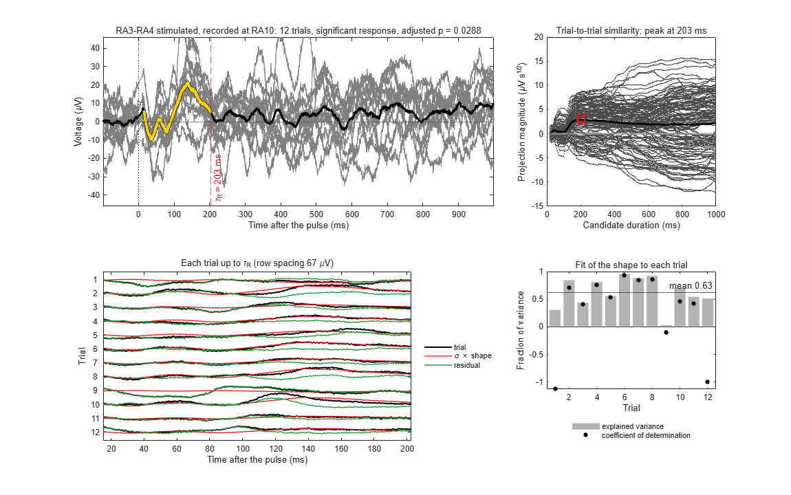

```matlab
% Tutorial extract
ieeglab_plot_crp(EEG, 'RA3-RA4', 'RA10');
% Full recording
ieeglab_plot_crp(EEG, 'RX4-RX5', 'RF2');
```

### 9. Connectivity matrix

**iEEGLAB > Plot connectivity matrix**: *Significant responses*, then *CRP explained variance*.

> **Expect.** Each row is a stimulated pair, each column a recording contact; a cell shows whether stimulating that
> pair evoked a response at that contact. Teal: a significant response; white: tested, no response; grey: not tested
> (the stimulated contacts themselves, bad contacts, sites with too few trials). Read a row to see where a site's
> stimulation reaches, a column to see which sites reach a contact. The second view colours the responding pairs by
> CRP explained variance, how much of each trial the response shape explains (0 to 1).
>
> - *Tutorial extract:* 3 sites by 14 contacts.
> - *Full recording:* 57 sites by 198 contacts.

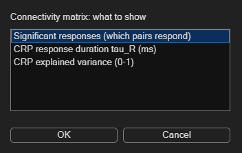

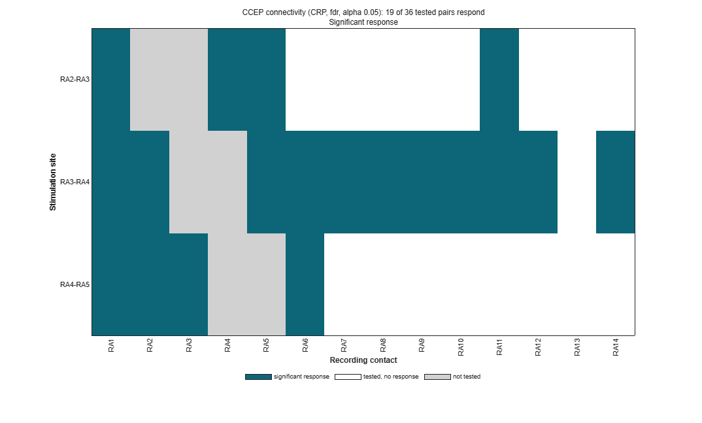

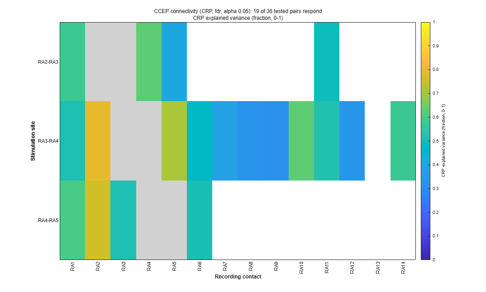

```matlab
pop_ieeglab_ccep_matrix(EEG, 'response');
pop_ieeglab_ccep_matrix(EEG, 'explained_var');
```

### 10. In-degree on the brain

**iEEGLAB > Plot electrode values on brain**: *In-degree*.

> **Expect.** Each contact coloured by the number of sites that evoke a response there.

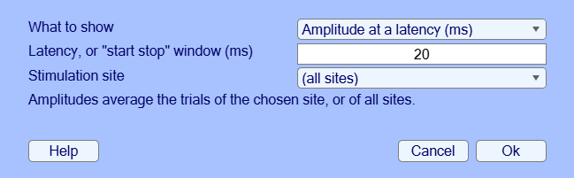

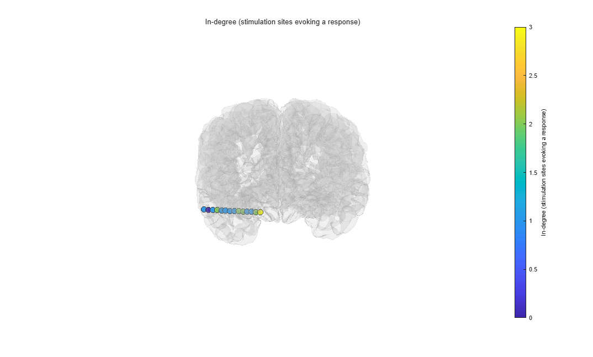

```matlab
pop_ieeglab_topoplot(EEG, 'in_degree');
```

### 11. Export

**iEEGLAB > Export results**: choose a folder.

> **Expect.** TSV tables (BIDS derivatives style), a JSON record of every option used, and a MAT file.

```matlab
ieeglab_export(EEG, 'results_seeg');
```

### 12. Time-frequency

**iEEGLAB > Frequency analysis**: *Time-frequency power and band power*, keep the defaults (5 to 200 Hz, Hann windows
of 0.2 s, dB against the baseline, high-frequency activity 70-150 Hz). It only draws figures: the dataset is not
changed. Then, optionally, the same again with *Test each contact's band power in this window against its baseline*
ticked (the box is not in the screenshot yet).

> **Expect.** Two figures. The first shows the power of the average of the contacts over time and frequency, and the
> 70-150 Hz power of every contact over time; the second, each contact's 70-150 Hz power from 0 to 1000 ms on the
> brain. The times from -100 to 110 ms are grey: a window that contains the pulse shows power at every frequency. Each
> contact's own stimulation epochs are left out of its average.
>
> - *Tutorial extract:* Over 0 to 1000 ms, the 70-150 Hz power of every contact but RA14 is 0.1 dB (RA7) to 0.5 dB
>   (RA4) below its baseline (median -0.3 dB). RA14 is 3.8 dB below: a burst of power about 350 ms before the pulse
>   (the bright patch in its row) raises its baseline, and it also makes the stripe at that time and most of the blue
>   below 60 Hz after the pulse in the average. The grey band covers the first 110 ms, where the responses to a single
>   pulse are largest. With *Window* 0.1 s the map starts at 70 ms.
> - *Full recording:* Over 0 to 1000 ms, every contact's 70-150 Hz power is between 0.3 dB below (RF13) and 0.4 dB
>   above (RZ1) its baseline (median 0.0 dB), except RA14 (1.7 dB below) and LX12 (1.4 dB below).

> **Expect, with the test.** Each contact's 70-150 Hz change from 0 to 1000 ms is tested against its baseline over
> the epochs (sign-flip permutation, false discovery rate across contacts). The command window gives the count, the
> second panel stars the contacts that differ (when it names each contact: 60 or fewer), and the brain shows only them,
> or every contact's tested change when none differs.
>
> - *Tutorial extract:* No contact differs (smallest corrected p 0.20). The test averages each epoch's change in dB:
>   for RA14 it is -0.2 dB, where the average power, which the burst in its baseline dominates, gives -3.8 dB. RA3,
>   with 9 epochs, cannot reach significance after the correction and is marked not testable.
> - *Full recording:* About 2 minutes; the single-epoch band power takes about 1.7 GB of memory. No contact differs
>   (smallest corrected p 0.06).

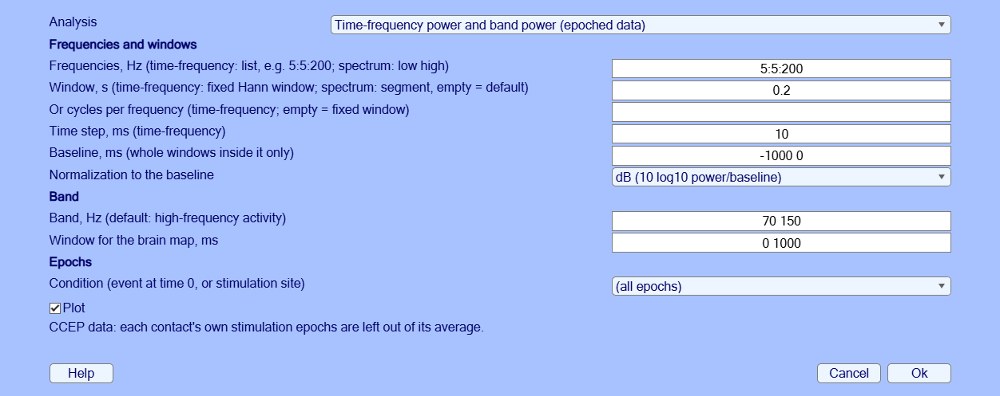

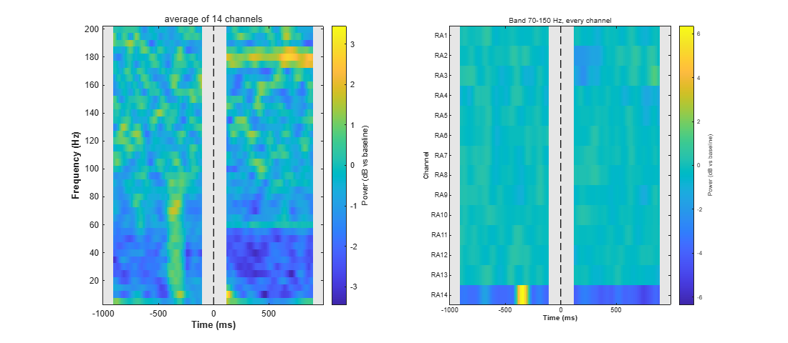

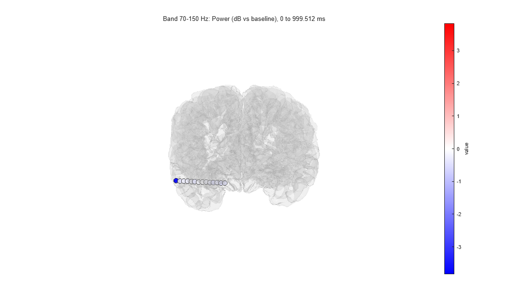

```matlab
EEG = pop_ieeglab_spectral(EEG, 'type', 'timefreq');
EEG = pop_ieeglab_spectral(EEG, 'type', 'timefreq', 'stats', true);   % with the test
```

### 13. Power spectrum

**iEEGLAB > Frequency analysis**: *Power spectrum of each contact*, keep the defaults.

> **Expect.** One curve per contact on a log scale, their median in black, falling steeply with frequency, and the
> 70-150 Hz power on the brain. On stimulation epochs the spectrum uses only the part before the pulse: the 1 s window
> is shortened to 0.95 s, one segment per epoch.
>
> - *Tutorial extract:* No peak at 60 or 120 Hz in the median: the line noise was removed. One is left at 180 Hz
>   (about 3.5 times the neighbouring frequencies in the median); the largest is on RA3 (40 times), next to the
>   stimulated pairs.
> - *Full recording:* No peak at the line frequency or its harmonics in the median: the line noise was removed. The
>   largest peaks left are on LB3, at 60 Hz (20 times the neighbouring frequencies) and 180 Hz (12 times).

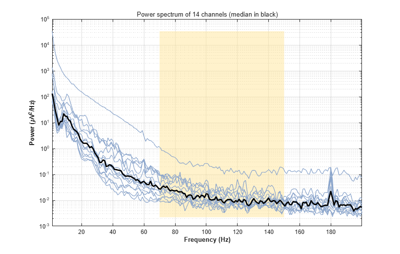

```matlab
EEG = pop_ieeglab_spectral(EEG, 'type', 'spectrum');
```

### 14. Bipolar

**iEEGLAB > iEEG re-referencing**: choose *Bipolar* in *Method*, keep the default (pairs farther apart than twice their
lead's spacing are not formed).

> **Expect.** Each contact minus the next one on its lead, at the midpoint of the two. The CCEP results are removed:
> they describe the old channels. A bipolar difference cancels any reference common to its two contacts, so the same
> channels come from the CARLA data as from the preprocessed ones.
>
> - *Tutorial extract:* The 14 contacts become 13 channels, RA1-RA2 to RA13-RA14.
> - *Full recording:* 196 contacts become 157 channels. 21 pairs are not formed: their contacts are 7 to 14 mm apart
>   where their lead's are 3.3 to 4.2 mm (gaps between groups of contacts, e.g. LB5-LB6, RB5-RB6); RO11 and ROP4 have
>   no neighbour.

```matlab
EEG = pop_ieeglab_reref(EEG, 'method', 'bipolar');
```

### 15. Time-frequency, bipolar

**iEEGLAB > Frequency analysis** again: *Time-frequency power and band power*, on the bipolar channels.

> **Expect.** As in step 12, one row per bipolar channel.
>
> - *Tutorial extract:* RA3-RA4 has no value: RA3 or RA4 is stimulated in every epoch (sites RA2-RA3, RA3-RA4 and
>   RA4-RA5). RA13-RA14 is 4.3 dB below its baseline (RA14's burst again), RA1-RA2 1.0 dB and RA2-RA3 0.8 dB below;
>   the others are between -0.5 and +0.1 dB.
> - *Full recording:* Every channel stays within 0.3 dB of its baseline (highest: RZ1-RZ2), except RA13-RA14 (2.2 dB
>   below) and LX11-LX12 (0.7 dB below).

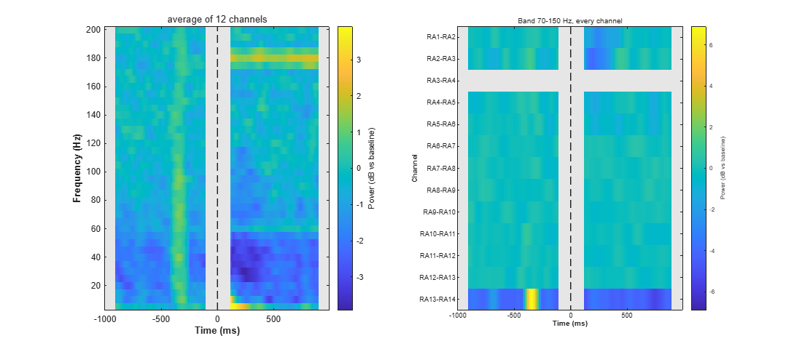

```matlab
EEG = pop_ieeglab_spectral(EEG, 'type', 'timefreq');
```

## Something differs?

If a result differs from *Expect* or from the picture, a step fails, or a window is unclear, please open an
[issue](https://github.com/sccn/iEEGLAB/issues) with the message and the MATLAB command window, and the MATLAB and
EEGLAB versions and operating system.

## References

- de Cheveigné, A. (2020). ZapLine: A simple and effective method to remove power line artifacts. *NeuroImage, 207*,
  116356.
- Huang, H., Ojeda Valencia, G., Gregg, N. M., Osman, G. M., Montoya, M. N., Worrell, G. A., Miller, K. J., & Hermes,
  D. (2024). CARLA: Adjusted common average referencing for cortico-cortical evoked potential data. *Journal of
  Neuroscience Methods, 407*, 110153.
- Klug, M., & Kloosterman, N. A. (2022). Zapline-plus: A Zapline extension for automatic and adaptive removal of
  frequency-specific noise artifacts in M/EEG. *Human Brain Mapping, 43*(9), 2743-2758.
- Miller, K. J., Müller, K.-R., Ojeda Valencia, G., Huang, H., Gregg, N. M., Worrell, G. A., & Hermes, D. (2023).
  Canonical response parameterization: Quantifying the structure of responses to single-pulse intracranial electrical
  brain stimulation. *PLOS Computational Biology, 19*(5), e1011105.
- Ojeda Valencia, G., Gregg, N. M., Huang, H., Lundstrom, B. N., Brinkmann, B. H., Pal Attia, T., Van Gompel, J. J.,
  Bernstein, M. A., In, M.-H., Huston, J., III, Worrell, G. A., Miller, K. J., & Hermes, D. (2023). Signatures of
  electrical stimulation driven network interactions in the human limbic system. *Journal of Neuroscience, 43*(39),
  6697-6711.
