# ECoG: cortico-cortical evoked potentials (ds004080)

The same analysis as on the [sEEG page](1-sEEG-CCEP-ds004696.md), on ECoG grids and strips: single-pulse electrical
stimulation through pairs of neighbouring contacts, the N1 response at every other contact, the connectivity matrix,
time-frequency power and a bipolar montage. The participant is sub-ccepAgeUMCU02 of OpenNeuro ds004080 (van Blooijs et
al., 2023).

The differences from the sEEG page: the coordinates are on fsaverage (the dataset shares no MRI), the line noise is at
50 Hz, the reference is the common average of the good contacts, and the response is measured by the N1 (van Blooijs et
al., 2018). Each step gives the menu, what you should get (*Expect*), the window or figure that opens (from the
tutorial extract), and the same step from the command line. Install iEEGLAB first
([Installation](https://github.com/sccn/iEEGLAB#installation)).

## Data

Two versions of the same recording; the steps give the numbers of both where they differ.

- **Tutorial extract**: nothing to download, a few minutes for all the steps. `tutorial/ecog` in the iEEGLAB folder
  holds an extract at the native sampling rate with its BIDS sidecar files: 20 contacts, 3 stimulation sites,
  30 pulses.
- **Full recording**: one run of sub-ccepAgeUMCU02 from OpenNeuro, with the
  [AWS command line](https://aws.amazon.com/cli/) (no account needed) or from
  [ds004080](https://openneuro.org/datasets/ds004080). Keep the folder structure. Reading it needs the **bva-io**
  plugin (**File > Manage EEGLAB extensions**).

```
aws s3 sync --no-sign-request s3://openneuro.org/ds004080 ds004080 --exclude "*" --include "sub-ccepAgeUMCU02/ses-1/ieeg/*run-041456*" --include "sub-ccepAgeUMCU02/ses-1/ieeg/*_ses-1_electrodes.*" --include "sub-ccepAgeUMCU02/ses-1/ieeg/*_ses-1_coordsystem.json" --include "dataset_description.json" --include "participants.tsv"
```

The contacts are drawn on fsaverage's pial surfaces: FreeSurfer has them, or get them once from Python with
`import mne; mne.datasets.fetch_fsaverage()` (if MNE says its download folder does not exist, create it first;
iEEGLAB uses only `surf/lh.pial` and `surf/rh.pial`).

## Steps

### 1. Load the data

**Tutorial extract:** **File > Load existing dataset**: in the iEEGLAB folder,
`tutorial/ecog/sub-ccepAgeUMCU02_ses-1_task-SPESclin_run-041456_ieeg.set`.

**Full recording:** **iEEGLAB > Import raw recording**: select the `ds004080` folder (with several runs downloaded,
choose run-041456). Keep the defaults.

> **Expect.**
>
> - *Tutorial extract:* 20 channels at 2048 Hz, 2.9 minutes.
> - *Full recording:* A few seconds, with the progress shown: 88 ECoG channels at 2048 Hz.

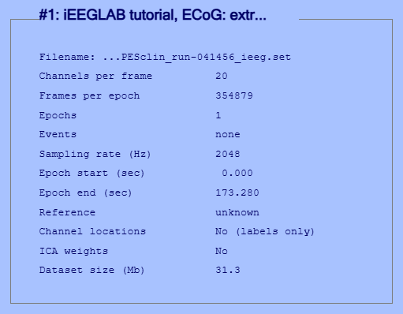

Full recording, the import window:

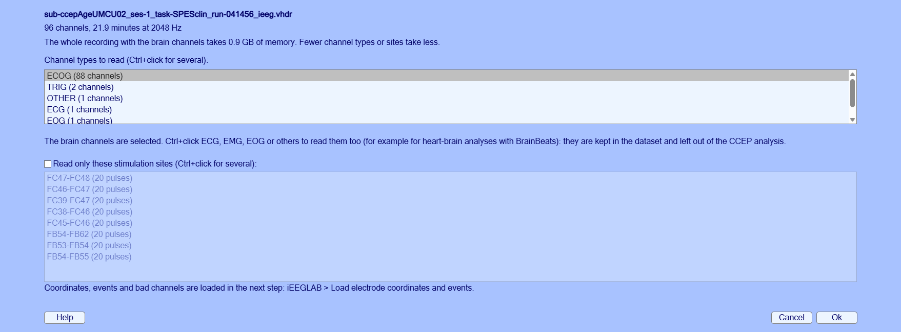

```matlab
% Tutorial extract
tut = fullfile(fileparts(which('eegplugin_ieeglab')), 'tutorial', 'ecog');
EEG = pop_loadset('filename', 'sub-ccepAgeUMCU02_ses-1_task-SPESclin_run-041456_ieeg.set', 'filepath', tut);
% Full recording
rec = fullfile('ds004080', 'sub-ccepAgeUMCU02', 'ses-1', 'ieeg', 'sub-ccepAgeUMCU02_ses-1_task-SPESclin_run-041456_ieeg.vhdr');
EEG = ieeglab_import(rec);
```

### 2. Coordinates and events

**iEEGLAB > Load electrode coordinates and events**: Ok in both windows.

> **Expect.**
>
> - *Tutorial extract:* 20 contacts with coordinates, 2 bad (F07, F08); 30 stimulations at 3 sites.
> - *Full recording:* 88 contacts with coordinates, 2 bad; 160 stimulations at 8 sites.

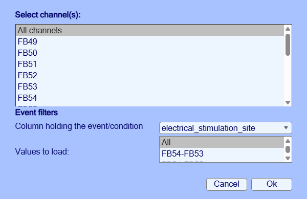

```matlab
EEG = ieeglab_load(EEG, struct('event_field', 'electrical_stimulation_site'));
```

### 3. Brain surfaces

**iEEGLAB > Choose brain surfaces**: *Use these*, then **iEEGLAB > Visualize electrodes**. This dataset shares no MRI;
its coordinates are on fsaverage, so fsaverage's pial surfaces are offered.

> **Expect.** The grid and strip contacts on the left frontal cortex of fsaverage, seen face-on. The grid does not look
> regular: the dataset moved its contacts to fsaverage with a surface-based transformation that, as its README says,
> distorts the grid but keeps the gyral anatomy.

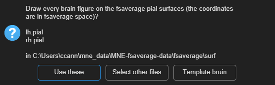

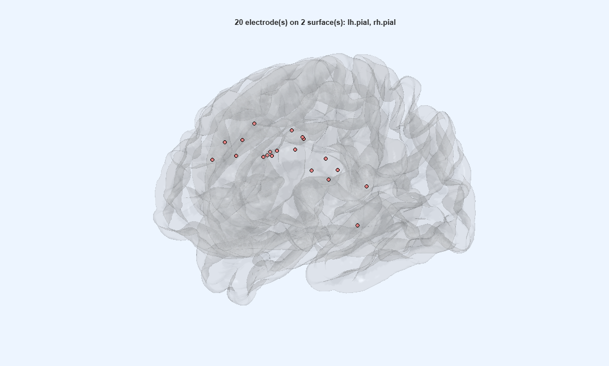

```matlab
EEG = pop_ieeglab_surfaces(EEG, 'surf_files', ieeglab_brain_surfaces(EEG));
EEG = ieeglab_vis_elec(EEG);
```

### 4. Preprocess

**iEEGLAB > Preprocess iEEG data**: tick *Reject outlier trials*, keep the rest (line noise at 50, 100 and 150 Hz
here).

> **Expect.**
>
> - *Tutorial extract:* A few seconds: 18 contacts, 30 epochs.
> - *Full recording:* About 10 s: 86 contacts, 160 epochs.

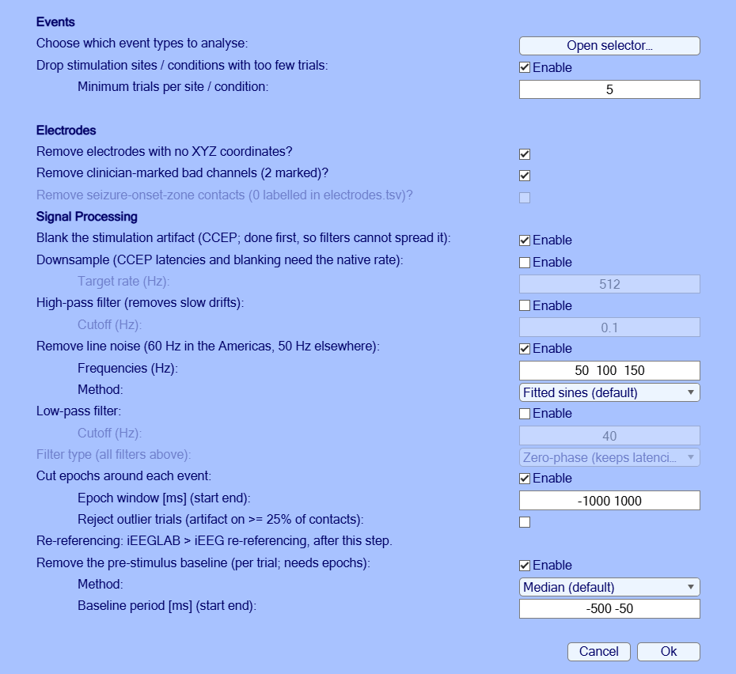

```matlab
EEG = ieeglab_preprocess(EEG, struct('apply_blank', true, 'apply_notch', true, 'notch', [50 100 150], ...
    'apply_epoch', true, 'epoch_window', [-1000 1000], 'reject_trials', true, ...
    'remove_rare_cond', true, 'min_trials', 5, 'remove_no_coords', true, ...
    'remove_bad_channels', true, 'apply_baseline', true, 'baseline_period', [-500 -50]));
```

### 5. Average heatmap

**iEEGLAB > Plot average of epochs, every channel (heatmap)**.

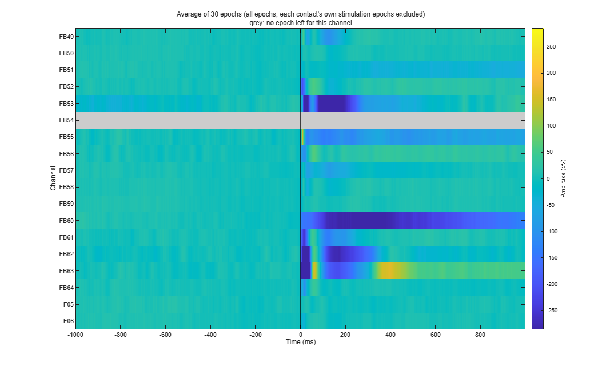

```matlab
ieeglab_plot_heatmap(EEG);
```

### 6. Common average

**iEEGLAB > iEEG re-referencing**: choose *Common average* in *Method* (the window opens on CARLA).

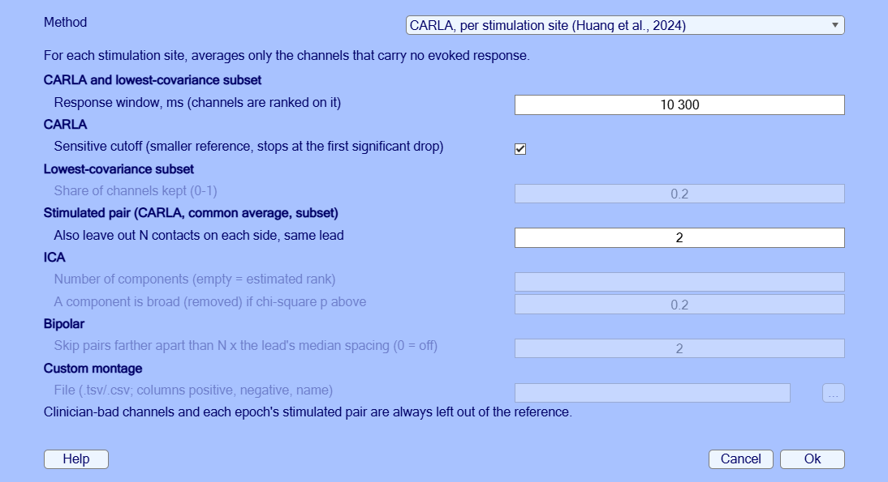

```matlab
EEG = pop_ieeglab_reref(EEG, 'method', 'car');
```

### 7. CCEP analysis

**iEEGLAB > CCEP analysis**: defaults (N1 on ECoG, matrix from N1). The N1 is the largest negative peak 10 to 100 ms
after the pulse (van Blooijs et al., 2018), tested with a sign-flip permutation test across trials (false discovery
rate across the contacts of each site). Only negative peaks count, as in ER-detect (van den Boom et al., 2025), whose
detection rule (a peak above 3.4 times the baseline SD) is an option.

> **Expect.**
>
> - *Tutorial extract:* A few seconds: 10 of 48 pairs respond, N1 latency median 21 ms (14 to 99 ms).
> - *Full recording:* About 10 s: 299 of 672 pairs respond, N1 latency median 47 ms (11 to 99 ms).

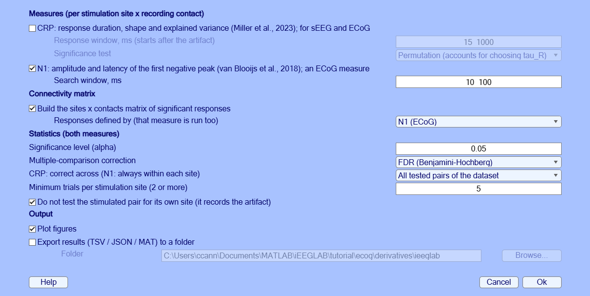

```matlab
EEG = ieeglab_stats_subject(EEG, struct('run_n1', true, 'run_crp', false, 'run_matrix', true, 'matrix_source', 'n1'));
```

### 8. Connectivity matrix

**iEEGLAB > Plot connectivity matrix**: *Significant responses*, then *N1 latency*.

> **Expect.** As on the sEEG page: rows are stimulated pairs, columns recording contacts, teal for a significant N1,
> white for none, grey for not tested. The second view colours the responding pairs by N1 latency, in ms after the
> pulse.

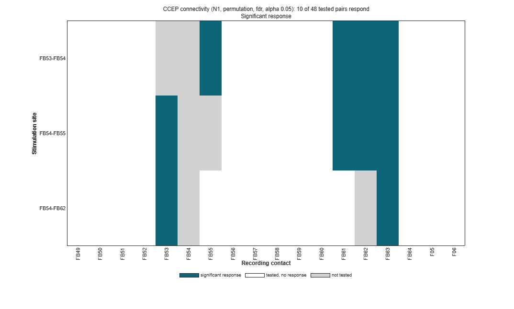

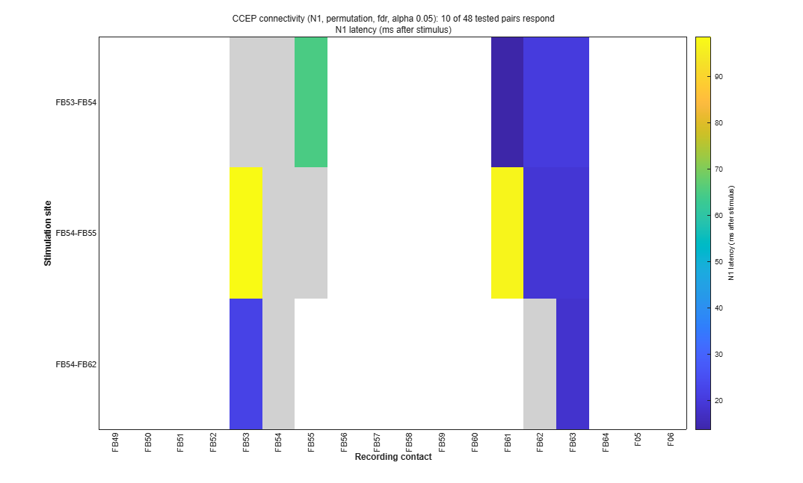

```matlab
pop_ieeglab_ccep_matrix(EEG, 'response');
pop_ieeglab_ccep_matrix(EEG, 'latency_ms');
```

### 9. N1 on the brain

**iEEGLAB > Plot electrode values on brain**: *N1 amplitude*, site FB54-FB62. Then, to keep the results,
**iEEGLAB > Export results**.

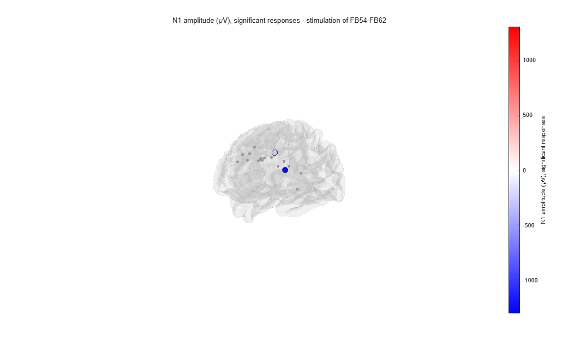

```matlab
pop_ieeglab_topoplot(EEG, 'n1_amplitude', 'site', 'FB54-FB62');
ieeglab_export(EEG, 'results_ecog');
```

### 10. Time-frequency

**iEEGLAB > Frequency analysis**: *Time-frequency power and band power*, keep the defaults (5 to 200 Hz, Hann windows
of 0.2 s, dB against the baseline, high-frequency activity 70-150 Hz). It only draws figures: the dataset is not
changed. Then, optionally, the same again with *Test each contact's band power in this window against its baseline*
ticked (the box is not in the screenshot yet).

> **Expect.** Two figures. The first shows the power of the average of the contacts over time and frequency, and the
> 70-150 Hz power of every contact over time; the second, each contact's 70-150 Hz power from 0 to 1000 ms on the
> brain. The times from -100 to 110 ms are grey: a window that contains the pulse shows power at every frequency. Each
> contact's own stimulation epochs are left out of its average.
>
> - *Tutorial extract:* Over 0 to 1000 ms, every contact's 70-150 Hz power is between 0.6 dB below its baseline (FB51)
>   and 0.3 dB above (FB55 and FB62). FB63 dips, then rises, in the 300 ms after the grey band, which averages out over
>   the second. FB54 has no value: it is stimulated at all three sites of the extract.
> - *Full recording:* No contact's 70-150 Hz power differs from its baseline by more than 0.4 dB over 0 to 1000 ms
>   (highest: FB55).

> **Expect, with the test.** Each contact's 70-150 Hz change from 0 to 1000 ms is tested against its baseline over
> the epochs (sign-flip permutation, false discovery rate across contacts). The command window gives the count, the
> second panel stars the contacts that differ (when it names each contact: 60 or fewer), and the brain shows only them,
> or every contact's tested change when none differs.
>
> - *Tutorial extract:* No contact differs (smallest corrected p 0.34). FB54, stimulated in every epoch, is not tested.
> - *Full recording:* No contact differs (smallest corrected p 0.11).

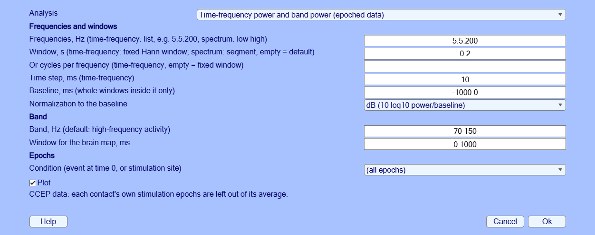

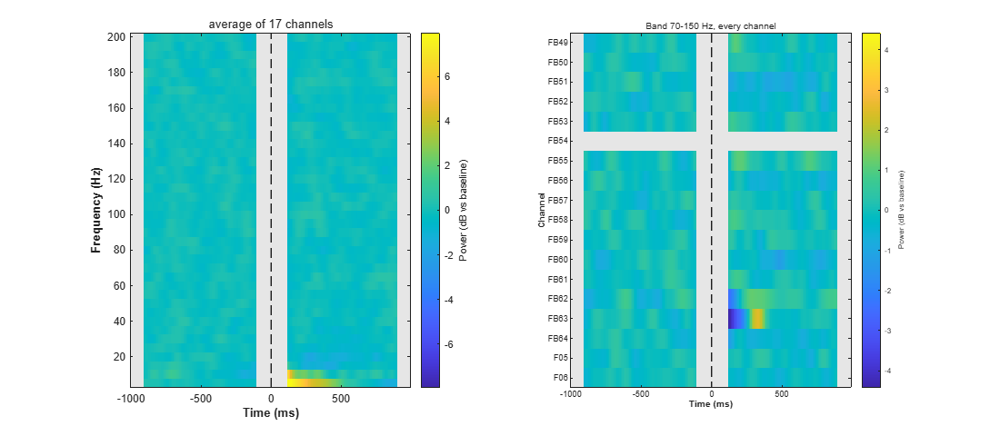

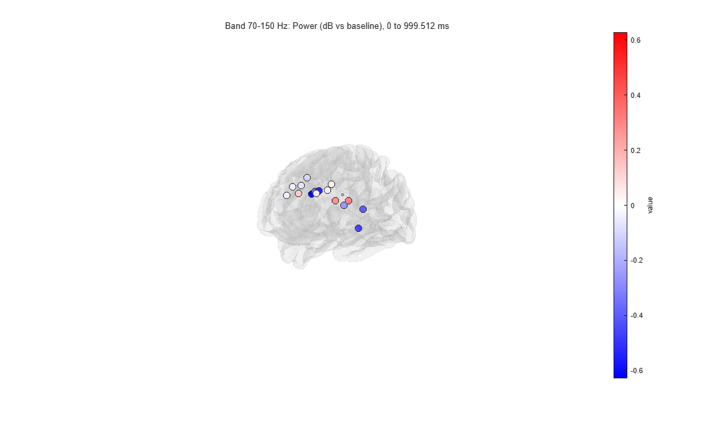

```matlab
EEG = pop_ieeglab_spectral(EEG, 'type', 'timefreq');
EEG = pop_ieeglab_spectral(EEG, 'type', 'timefreq', 'stats', true);   % with the test
```

### 11. Power spectrum

**iEEGLAB > Frequency analysis**: *Power spectrum of each contact*, keep the defaults.

> **Expect.** One curve per contact on a log scale, their median in black, falling steeply with frequency, and the
> 70-150 Hz power on the brain. On stimulation epochs the spectrum uses only the part before the pulse: the 1 s window
> is shortened to 0.95 s, one segment per epoch. No peak at the line frequency or its harmonics in the median: the
> line noise was removed.
>
> - *Tutorial extract:* The largest peak left is on FB53 at 100 Hz, next to the stimulated FB54.
> - *Full recording:* No peak above 2.5 times the neighbouring frequencies on any contact.

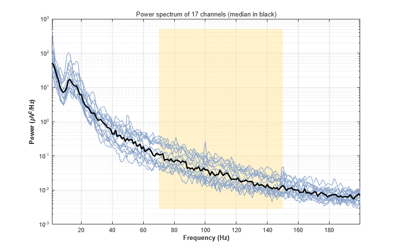

```matlab
EEG = pop_ieeglab_spectral(EEG, 'type', 'spectrum');
```

### 12. Bipolar

**iEEGLAB > iEEG re-referencing**: choose *Bipolar* in *Method*, keep the default (pairs farther apart than twice their
lead's spacing are not formed).

> **Expect.** Each contact minus the next one on its lead, at the midpoint of the two. The CCEP results are removed:
> they describe the old channels. A bipolar difference cancels any reference common to its two contacts, so the same
> channels come from the common average data as from the preprocessed ones.
>
> - *Tutorial extract:* 17 contacts become 14 channels. FB56-FB57 (79 mm apart) and FB63-FB64 (29 mm) are not formed,
>   as the lead's contacts are 13.4 mm apart: the grid's numbering runs on from one row to the next.
> - *Full recording:* 85 contacts become 71 channels. Ten pairs are not formed, their contacts being more than twice
>   their lead's spacing apart: the ends of grid rows (FC08-FC09, FC16-FC17, FC24-FC25, FC32-FC33, FC40-FC41,
>   FB56-FB57) and wider gaps on other leads (F04-F05, FB63-FB64, vT3-vT4, vT6-vT7).

```matlab
EEG = pop_ieeglab_reref(EEG, 'method', 'bipolar');
```

### 13. Time-frequency, bipolar

**iEEGLAB > Frequency analysis** again: *Time-frequency power and band power*, on the bipolar channels.

> **Expect.** As in step 10, one row per bipolar channel.
>
> - *Tutorial extract:* FB53-FB54 and FB54-FB55 have no value (FB54 is stimulated in every epoch); the others are
>   between -0.6 dB (FB50-FB51) and +0.2 dB.
> - *Full recording:* Every channel stays within 0.25 dB of its baseline (highest: FB55-FB56).

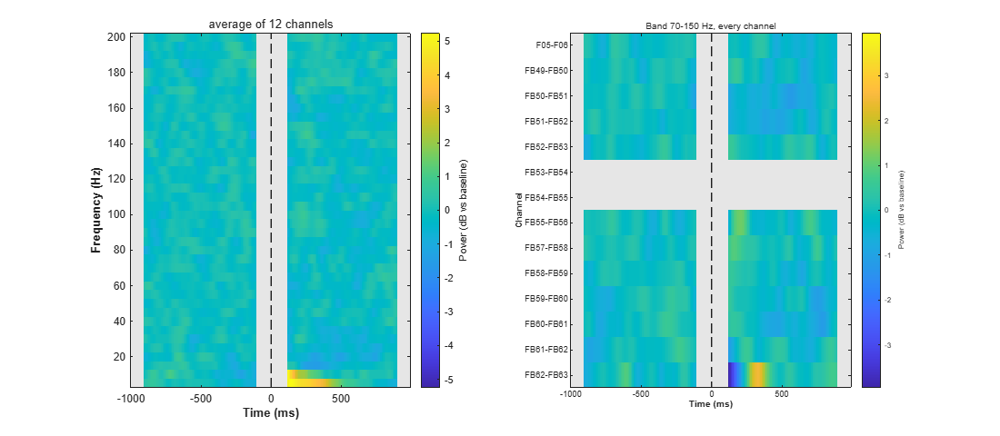

```matlab
EEG = pop_ieeglab_spectral(EEG, 'type', 'timefreq');
```

## Something differs?

If a result differs from *Expect* or from the picture, a step fails, or a window is unclear, please open an
[issue](https://github.com/sccn/iEEGLAB/issues) with the message and the MATLAB command window, and the MATLAB and
EEGLAB versions and operating system.

## References

- van Blooijs, D., Leijten, F. S. S., van Rijen, P. C., Meijer, H. G. E., & Huiskamp, G. J. M. (2018). Evoked
  directional network characteristics of epileptogenic tissue derived from single pulse electrical stimulation.
  *Human Brain Mapping, 39*(11), 4611-4622.
- van Blooijs, D., van den Boom, M. A., van der Aar, J. F., Huiskamp, G. M., Castegnaro, G., Demuru, M., Zweiphenning,
  W. J. E. M., van Eijsden, P., Miller, K. J., Leijten, F. S. S., & Hermes, D. (2023). Developmental trajectory of
  transmission speed in the human brain. *Nature Neuroscience, 26*(4), 537-541.
- van den Boom, M. A., Gregg, N. M., Ojeda Valencia, G., Lundstrom, B. N., Miller, K. J., van Blooijs, D., Huiskamp,
  G. J. M., Leijten, F. S. S., Worrell, G. A., & Hermes, D. (2025). ER-detect: A pipeline for robust detection of
  early evoked responses in BIDS-iEEG electrical stimulation data. *Journal of Neuroscience Methods, 418*, 110389.
