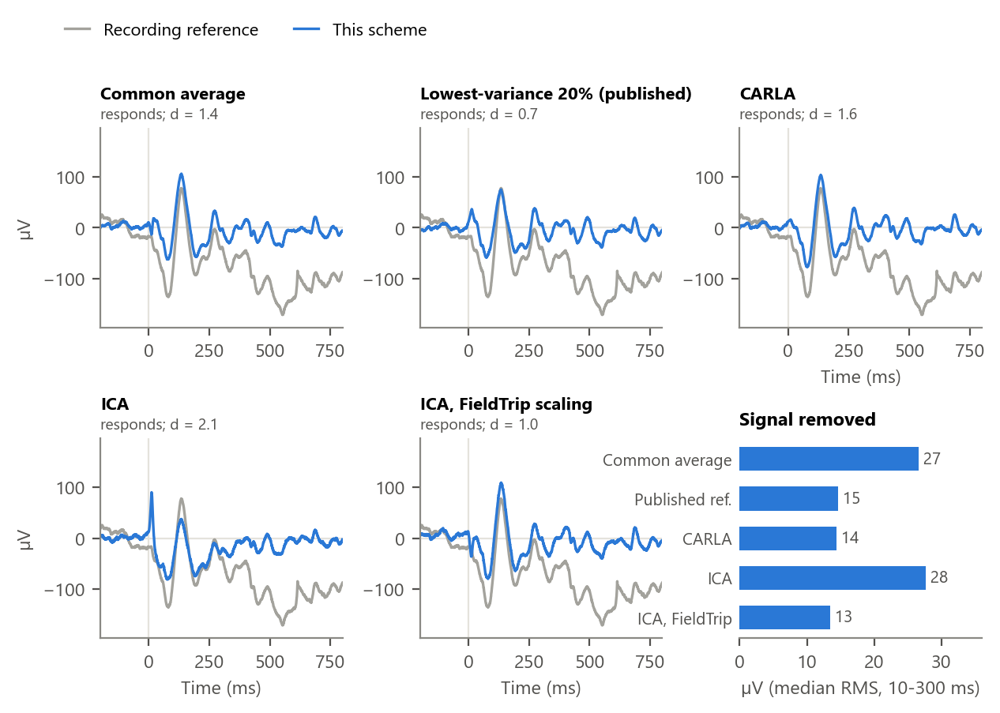
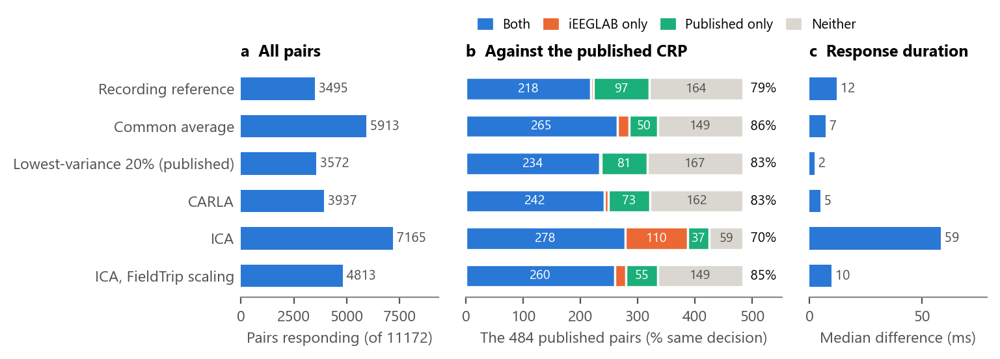
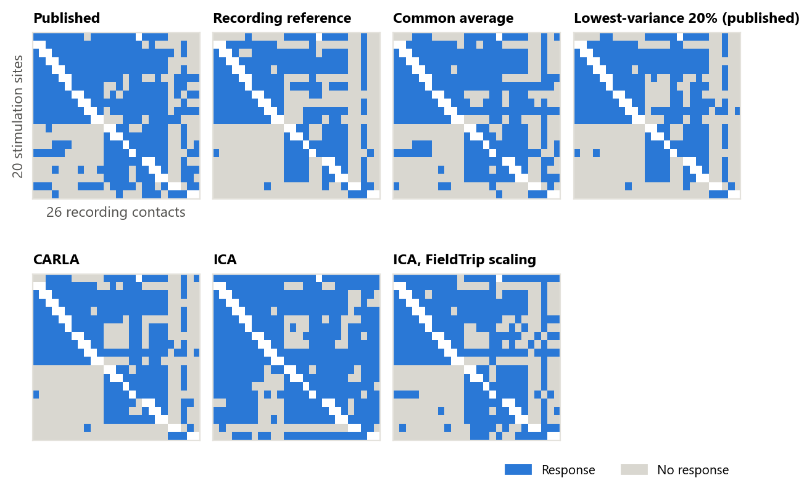
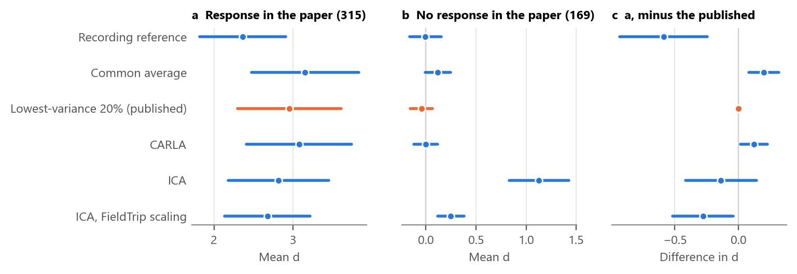

# Re-referencing schemes compared (ds004696)

The analysis of Ojeda Valencia et al. (2023) on ds004696 sub-02, CRP of every stimulation site and recording contact and the connectivity matrix, run once with each re-referencing scheme of iEEGLAB and compared with the published result. The paper's own reference is a common average of the 20% of contacts with the lowest variance from 15 to 500 ms in each block of 64 recording channels (the *published reference* below). Full recording only. Install iEEGLAB first ([Installation](https://github.com/sccn/iEEGLAB#installation)). About 4 hours of computing in all on a Windows laptop with 8 cores alongside other jobs, most of it ICA; about 1 hour on a recent Mac.

## Data

sub-02 of [ds004696](https://openneuro.org/datasets/ds004696), as on the [sEEG page](1-sEEG-CCEP-ds004696.md), and the published CRP of this participant (`derivatives/stats/sub-02`):

```
aws s3 sync --no-sign-request s3://openneuro.org/ds004696 ds004696 --exclude "*" --include "sub-02/*" --include "derivatives/freesurfer/sub-02/*" --include "derivatives/stats/sub-02/*" --include "dataset_description.json" --include "participants.tsv"
```

## Preprocess once

### 1. Import and preprocess

Steps 1, 2 and 4 of the [sEEG page](1-sEEG-CCEP-ds004696.md), with the full recording: **iEEGLAB > Import raw recording**, **Load electrode coordinates and events**, **Preprocess iEEG data**. Every scheme below starts from this dataset: go back to it in the **Datasets** menu before each one.

> **Expect.** 198 contacts, 627 epochs, 57 stimulation sites.

## Each scheme, then the CCEP analysis

For each: back to the preprocessed dataset, **iEEGLAB > iEEG re-referencing** with the method below, then **iEEGLAB > CCEP analysis** with its defaults (CRP from 15 ms to 1 s, permutation test, false discovery rate over all 11172 pairs; step 7 of the sEEG page counts 392 of them, at two sites with 5 and 6 trials, as not tested, as they cannot reach significance there). *Expect* gives the pairs that respond and how many of the 484 pairs of the published CRP get the same decision (315 respond there with the paper's test: the t-test at the response duration, Benjamini-Yekutieli correction over its pairs). The effect size *d* says how strong a response is: each trial projected onto the average of the other trials from 15 ms to 1 s, mean over standard deviation, so it rises when the response grows or its trial-to-trial variability falls. Its mean over the paper's responding pairs is given with a 95% confidence interval over the 20 stimulation sites.

### 2. Recording reference

No re-referencing: **iEEGLAB > CCEP analysis** on the preprocessed dataset itself.

> **Expect.** CCEP analysis 42 s. 3495 of 11172 pairs respond. On the paper's 484 pairs, the same decision for 79%: 218 respond in both, 5 in iEEGLAB only, 97 in the paper only. Effect size on the pairs that respond in the paper: d = 2.37 [1.82, 2.91].

```matlab
EEG = ieeglab_stats_subject(EEG, struct('run_n1', false, 'run_crp', true, 'run_matrix', true, 'matrix_source', 'crp'));
```

### 3. Common average

**iEEGLAB > iEEG re-referencing**: *Common average (all good channels)*.

> **Expect.** Re-referencing 19 s. 5913 of 11172 pairs respond. On the paper's 484 pairs, the same decision for 86%: 265 respond in both, 20 in iEEGLAB only, 50 in the paper only. Effect size on the pairs that respond in the paper: d = 3.15 [2.47, 3.83]. What it removes: a median of 27 µV RMS over 10 to 300 ms.

```matlab
EEG = pop_ieeglab_reref(EEG, 'method', 'car');
EEG = ieeglab_stats_subject(EEG, struct('run_n1', false, 'run_crp', true, 'run_matrix', true, 'matrix_source', 'crp'));
```

### 4. Published reference

**iEEGLAB > iEEG re-referencing**: *Lowest-variance subset (Ojeda Valencia et al., 2023)*, keep the share at 0.2: the paper's own reference, the average of the 20% of contacts with the lowest variance from 15 to 500 ms in each block of 64 channels of the recording. iEEGLAB warns that the epochs are already baseline-corrected: here every scheme starts from the same preprocessed epochs, while the paper ranks its contacts before the baseline, which changes some of them ([Compared](#compared)).

> **Expect.** Re-referencing 23 s. 3572 of 11172 pairs respond. On the paper's 484 pairs, the same decision for 83%: 234 respond in both, 2 in iEEGLAB only, 81 in the paper only. Effect size on the pairs that respond in the paper: d = 2.95 [2.30, 3.61]. What it removes: a median of 15 µV RMS over 10 to 300 ms.

```matlab
EEG = pop_ieeglab_reref(EEG, 'method', 'varsubset', 'fraction', 0.2);
EEG = ieeglab_stats_subject(EEG, struct('run_n1', false, 'run_crp', true, 'run_matrix', true, 'matrix_source', 'crp'));
```

### 5. CARLA

**iEEGLAB > iEEG re-referencing**: *CARLA, per stimulation site (Huang et al., 2024)*, the window's default.

> **Expect.** Re-referencing about 7 minutes. The same responses as step 7 of the [sEEG page](1-sEEG-CCEP-ds004696.md). 3937 of 11172 pairs respond. On the paper's 484 pairs, the same decision for 83%: 242 respond in both, 7 in iEEGLAB only, 73 in the paper only. Effect size on the pairs that respond in the paper: d = 3.08 [2.41, 3.74]. What it removes: a median of 14 µV RMS over 10 to 300 ms.

```matlab
EEG = pop_ieeglab_reref(EEG, 'method', 'carla');
EEG = ieeglab_stats_subject(EEG, struct('run_n1', false, 'run_crp', true, 'run_matrix', true, 'matrix_source', 'crp'));
```

### 6. ICA

**iEEGLAB > iEEG re-referencing**: *ICA, local components only (Michelmann et al., 2018)*, keep the defaults.

> **Expect.** Re-referencing takes about 35 minutes on a recent Mac and took about 3.5 hours on a Windows laptop alongside other jobs (one ICA of 198 contacts; plan for a long run); 70 components spread evenly over the contacts are removed. 7165 of 11172 pairs respond. On the paper's 484 pairs, the same decision for 70%: 278 respond in both, 110 in iEEGLAB only, 37 in the paper only. Effect size on the pairs that respond in the paper: d = 2.82 [2.18, 3.45]. What it removes: a median of 28 µV RMS over 10 to 300 ms.

```matlab
[EEG, info] = ieeglab_icaref(EEG);   % keep info to try the other scaling without refitting
EEG = ieeglab_stats_subject(EEG, struct('run_n1', false, 'run_crp', true, 'run_matrix', true, 'matrix_source', 'crp'));
```

### 7. ICA, FieldTrip scaling

Command line only: the same decomposition, with the weights scaled as FieldTrip does, as in the authors' script (their 1 Hz high-pass is not applied here). Start from the preprocessed dataset again and pass the `info` of the previous step, so ICA is not fitted a second time.

> **Expect.** Re-referencing 9 s with the earlier decomposition; 6 components removed. 4813 of 11172 pairs respond. On the paper's 484 pairs, the same decision for 85%: 260 respond in both, 20 in iEEGLAB only, 55 in the paper only. Effect size on the pairs that respond in the paper: d = 2.68 [2.13, 3.22]. What it removes: a median of 13 µV RMS over 10 to 300 ms.

```matlab
EEG = ieeglab_icaref(EEG, struct('weights', 'fieldtrip', 'decomposition', info));
EEG = ieeglab_stats_subject(EEG, struct('run_n1', false, 'run_crp', true, 'run_matrix', true, 'matrix_source', 'crp'));
```

## Compared

At each main step: what re-referencing changes in the signal, which pairs respond, and the connectivity matrix, against the published result.



*The signal. One pair (RB2-RB3 to RZ1), trial average with each scheme (blue) against the recording's own reference (grey), with the pair's decision and effect size; the pulse artifact is clipped. Last panel: what each scheme removes, median over all pairs.*



*The CCEP analysis. (a) Pairs that respond. (b) The 484 published pairs: response in both, in iEEGLAB only, in the paper only, or in neither. (c) Median difference in response duration from the paper, where both find a response.*



*The connectivity matrix of the published pairs, in the paper and with each scheme. White: stimulated contact, not tested.*

The scheme changes how many pairs respond, from 3495 with the recording's reference to 7165 with ICA with iEEGLAB's scaling. Against the paper, the decisions agree on 70% (ICA with iEEGLAB's scaling) to 86% (the common average) of its pairs; 83% with the paper's own reference. iEEGLAB finds 2 to 110 responses the paper does not, and misses 37 to 97 of its 315: the preprocessing and the test differ (permutation and false discovery rate over all 11172 pairs, against the paper's t-test corrected over its own pairs). Where both find a response, the response duration is closest with the published reference (median difference 2 ms). With the paper's own settings (no filtering, blanking or trial rejection, its reference applied before the baseline, its t-test and correction), iEEGLAB reaches the paper's decision on all 484 pairs. Changed one at a time, the test changes the most: iEEGLAB's permutation test, which repeats the choice of response duration that the t-test makes on the same data, finds 160 of the paper's 315 responses with the paper's correction (Benjamini-Yekutieli; with 10 trials its p cannot fall below 0.002), and 248 (over all pairs) to 257 (over the paper's) with Benjamini-Hochberg. Trial rejection changes 17 decisions, and re-referencing after the baseline, as in the steps above, 26: the paper's reference ranks contacts by their variance over all trials, which includes each trial's offset.



*The strength of the responses. Mean effect size d with its 95% confidence interval over the stimulation sites, (a) on the pairs that respond in the paper, (b) on those that do not, (c) the difference from the published reference (orange) on the pairs of a.*

Effect sizes say how strong the responses are, not only whether they pass the test. On the 315 pairs that respond in the paper, the mean d is 2.95 with the published reference and largest with the common average (3.15). On the 169 that do not, it is highest with ICA with iEEGLAB's scaling (1.13, against -0.05). Against the published reference, with 95% confidence intervals: the recording's reference -0.59 [-0.93, -0.24] on the responding pairs and +0.04 [-0.10, +0.18] on the others; the common average +0.20 [+0.08, +0.32] on the responding pairs and +0.16 [+0.07, +0.25] on the others; CARLA +0.12 [+0.01, +0.23] on the responding pairs and +0.04 [-0.04, +0.12] on the others; ICA with iEEGLAB's scaling -0.14 [-0.42, +0.14] on the responding pairs and +1.17 [+0.86, +1.49] on the others; ICA with FieldTrip's scaling -0.28 [-0.52, -0.04] on the responding pairs and +0.29 [+0.20, +0.39] on the others. A scheme that raises *d* where the paper finds no response either spreads a signal across contacts or reveals responses the paper's reference hides; one that raises it only where the paper finds a response makes the responses stand out (with CARLA and the common average, mostly by lowering the trial-to-trial variability). The pairs without a response were chosen with the paper's reference, which favours it there. Selecting the pairs on half of the trials and measuring *d* on the other half, which favours no scheme, CARLA differs from the published reference by +0.08 [-0.01, +0.16] on the responding pairs and +0.08 [+0.04, +0.11] on the others.

The numbers of this section come from the three functions below, in the plugin's `validation` folder. They do not use the datasets of the steps above: `compare_references_ds004696` runs everything again from the raw recording, the ICA included (about 45 minutes on a recent Mac, several hours on the Windows laptop), and writes about 3 GB to its output folder; a second run reuses what is there. The two other functions start from its preprocessed epochs (`matched_pipeline_ds004696` also imports the recording again, for the paper's own settings). The figures are drawn from these files by a plotting script that is not part of the plugin.

```matlab
addpath(fullfile(fileparts(which('eegplugin_ieeglab')), 'validation'));
S = compare_references_ds004696('ds004696', 'ref_compare');   % all six, with the tables per pair
S2 = split_half_effects_ds004696('ds004696', 'ref_compare');   % effect sizes, selection on the other half
S3 = matched_pipeline_ds004696('ds004696', 'ref_compare');     % the paper's settings, then one change at a time
```

## Something differs?

If a result differs from *Expect* or from the picture, a step fails, or a window is unclear, please open an
[issue](https://github.com/sccn/iEEGLAB/issues) with the message and the MATLAB command window, and the MATLAB and
EEGLAB versions and operating system.

## References

- Huang, H., Ojeda Valencia, G., Gregg, N. M., Osman, G. M., Montoya, M. N., Worrell, G. A., Miller, K. J., & Hermes,
  D. (2024). CARLA: Adjusted common average referencing for cortico-cortical evoked potential data. *Journal of
  Neuroscience Methods, 407*, 110153.
- Michelmann, S., Treder, M. S., Griffiths, B., Kerrén, C., Roux, F., Wimber, M., Rollings, D., Sawlani, V.,
  Chelvarajah, R., Gollwitzer, S., Kreiselmeyer, G., Hamer, H., Bowman, H., Staresina, B., & Hanslmayr, S. (2018).
  Data-driven re-referencing of intracranial EEG based on independent component analysis (ICA). *Journal of
  Neuroscience Methods, 307*, 125-137.
- Ojeda Valencia, G., Gregg, N. M., Huang, H., Lundstrom, B. N., Brinkmann, B. H., Pal Attia, T., Van Gompel, J. J., Bernstein, M. A., In, M.-H., Huston, J., III, Worrell, G. A., Miller, K. J., & Hermes, D. (2023). Signatures of electrical stimulation driven network interactions in the human limbic system. *Journal of Neuroscience, 43*(39), 6697-6711.
